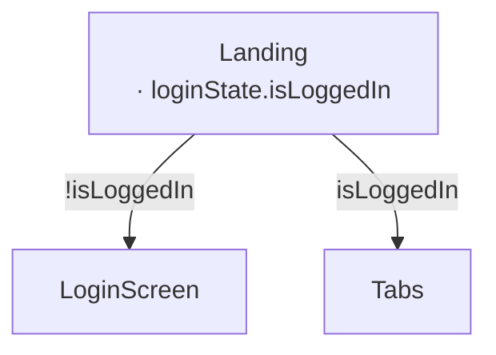
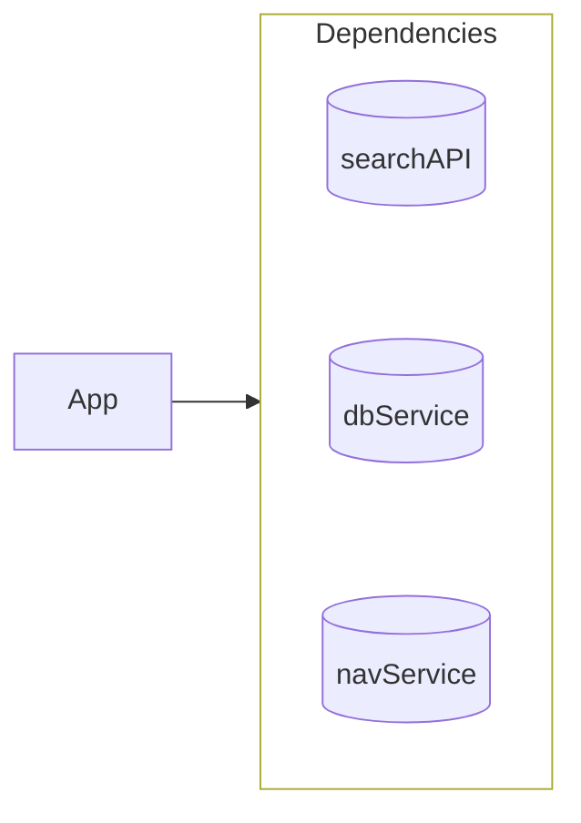
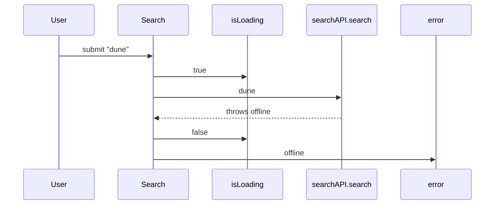

# hypermodular

**TDD is dead. Long live TDD: Top-Down Development.**

One map, one module, one boundary. An architecture method where the app
is modeled as small Mermaid maps that live in the repo, guide AI agents,
and cannot rot, because the global view is derived, not maintained.

This repo is a top-down app-making engine for agents, in two skills.
`hypermodular/` is the maps: draw the app, develop top-down, declare
evidence. `data-coupling/` is the code: how a SwiftUI node is written,
cut into shell and core, tested by its execution log, and how an app's
modules meet through one data layer. Point Claude, or any agent that
reads a `SKILL.md`, at either and it knows the method. Point it at both
and it writes the app, root down, each node proven by its log before
the next is started.

## The idea

Classic TDD, the mocks-all-the-way-down version that broke on every
refactor, deserved to die. What is worth keeping is the part that keeps
an AI agent honest: feedback it cannot talk its way out of.
Hypermodular delivers that with two declarations instead of rituals.

- **Structure before code.** The app is a tree of behavior, drawn before
  it is built. Development flows from the root to the leaves. An
  unbuilt node is a bare leaf on the map: mapped, reachable, empty.
  That is finished design, not missing work.
- **Evidence, not effects.** A node's behavior is declared as data:
  these values in, this execution log out. The log is its writes and
  boundary calls, in order, with their payloads. No mock objects, ever. A
  boundary in a spec is a logger, and checking a node is comparing two
  values.

## One law: depth 1, the cure for death by a thousand mocks

Every artifact describes one boundary, its own.

- A logged boundary never simulates deeper than one step (mock depth 1).
- Dependencies enter the flow at exactly one place, the root.
- A map draws exactly one level, a node and its immediate children.

Same law, three shadows. It keeps mocks, dependencies, and
documentation honest at the same time.

## The four diagrams

Every mapped node answers four questions, each with one small Mermaid
diagram in a `MAP.md` beside its code (`APP-MAP.md` at the repo root).

**1. Structure tree.** What is it made of? Solid arrows are data flow.
The parent hands the child facts, bindings, and callbacks. A node's
label carries its whole contract, one `·`-bulleted line per capability.
`· @Query` materializes a native source of truth, `· dbService.deleteBook()`
calls. The name stays the first line, whatever the renderer does.

A labeled arrow is a presence condition; arrows on the same deciding
value are alternatives. No diamonds.
LoginScreen is an unbuilt leaf. Nobody knows or cares yet what is
inside, and that is the point of top-down.

**2. Data coupling layer.** What vocabulary is shared? Models and
service signatures, consumption recorded with `..>`. Coupling is
consumption, not visibility. Everything is visible to everyone. Only use
creates a line.

**3. Dependencies.** What does the app ask of the world? All services
as cylinders in one box, set by the root with one plain arrow. Setting
a value is normal data flow. The column is ordered top to bottom in the
order the root sets them. A derived service lists its ingredients,
which must sit above it. Every dependency is an environment value: a
plain struct composed of closures, lets, or bindings. No protocols, no
classes.

Even navigation is a dependency. `navService.showDetail(id)` is a call
whose caller never knows which node answers, and cross-feature arrows
are forbidden. The state a route writes lives at the root, and callers
get closures. A node's own sheet or stack is its own state.

**4. Evidence.** What does it do at its edge? One sequence diagram per
acceptance criterion that crosses a boundary. Arrows into the node are
the *when*. Arrows out are the log, one entry each, in order, and the
test's array is exactly those arrows. Behavior renders in the PR next
to structure. A diagram and a test that disagree are an unreviewed
change.

## Hypermodular

One mermaid is one module is one boundary. No map knows more than one
level. The whole app reconstructs by merging nodes on their names, so
the global architecture view is always derivable and never maintained.
Hand-maintained architecture docs rot. A derived view can only reveal
disagreements between maps, which are exactly the bugs you want
surfaced.

Contracts are duplicated on purpose. A node's full label appears in its
parent's map and in its own. That is double-entry bookkeeping. The
merge compares the copies, and a mismatch is a detected, unreviewed
design change.

## Use it

- **Claude app / Cowork**: save `hypermodular/SKILL.md` and
  `data-coupling/SKILL.md` as skills, then ask Claude to "map this project", "plan this app top-down", or
  "review this view".
- **Claude Code CLI**: symlink (or copy) this repo's `hypermodular/` and
  `data-coupling/` folders into `~/.claude/skills/`, and swift-core-flow's
  `skill/` folder as `swift-core-flow` if you build with the macros, or
  work in a repo containing `APP-MAP.md`. `AGENTS.md` here teaches the rules to any
  agent that reads it (Cursor, Codex), and `CLAUDE.md` is one line
  importing it.
- **Reverse-engineering**: point the skill at an existing codebase and
  it extracts the maps. The first map of a legacy project is a free
  architecture review.

## The shelf

- [SwiftUI Data Flow Masterclass](https://medium.com/@redhotbits/swiftui-data-flow-masterclass-099f0768f776),
  the model: views as nodes, data in at creation, boundary events out,
  testing as reading the execution log.
- [TDD: Death by a Thousand Mocks](https://medium.com/@redhotbits/tdd-death-by-a-thousand-mocks-26adb60cbe43),
  the argument: flip the axis to authority; mock depth is what TDD died
  of.
- [TDD Is Dead. Long Live TDD.](https://medium.com/@redhotbits/tdd-is-dead-long-live-tdd-f85b4b9eacbd),
  the method: lift state and services, lock the core with its log,
  delegate the detail.
- [swift-core-flow](https://github.com/sisoje/swift-core-flow), the
  mechanics: macros for the functional-core / imperative-shell split,
  the execution log, and a hosted UI-test host that asserts it.
  Its `skill/SKILL.md` is the adoption skill, the method mechanized.
- **data-coupling** (this repo, `data-coupling/`), the code: the node
  model, lifting, the shell/core cut by hand or with `@Shell`, the
  execution log, the data coupling layer and the module graph.
- **hypermodular** (this repo, `hypermodular/`), the method: draw the
  maps, develop top-down, let evidence keep everyone honest.

## Origin

This method was distilled in one long conversation that started as a
LinkedIn reply about whether TDD is dead. It is. The acronym needed a
new expansion.
