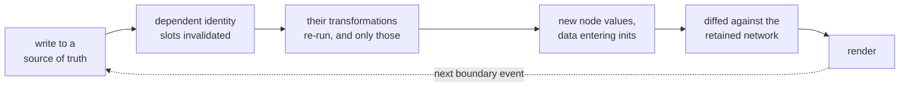

# The data-flow model: nodes, identity, waves

The runtime model everything else in the skill rests on. Read it when a
question is about how SwiftUI recomputes: identity, re-render
frequency, "why did my `@State` reset", "why isn't this updating", or
when someone argues SwiftUI needs an architecture bolted on to get
unidirectional data flow.

Source: the masterclass, with the mechanics Apple states in *Demystify
SwiftUI* (WWDC21).

## Get the noun right

A `SwiftUI.View` is not a view. It is a node in a network, views and
view modifiers alike, a plain value carrying everything its subtree
will show and do: data, closures, whole child subtrees. Calling it a
view is the wrong noun, and the wrong noun is why so much SwiftUI code
fights the framework instead of using it.

What a node shows but does not own (a `@State` flag, a `@Query` result)
it carries as a dependency, a declared claim on the storage that
supplies the value at creation. The runtime owns the pixels, not the
node.

Describe `View`, `ViewModifier`, `App`, and `Scene` by what they do and
you get four things with four mental models. Ask what they are and they
are one thing: values that are nodes in the reactive dataflow graph,
each carrying a list of dependencies needed to compute its output,
`body`. A `ViewModifier` also receives content as an upstream input.
`Scene` and `App` sit higher in the same graph.

The node-in-a-network claim predates SwiftUI. Flow-Based Programming
(J. Paul Morrison, 1970s) describes a system of independent nodes
communicating only through flows of discrete data packets. Structured
design (Yourdon & Constantine, 1979) names the discipline data
coupling: modules depending on each other only through plain values. It
is the loosest coupling that works. No shared mutable object, no
protocol both sides must know, no hidden channel. SwiftUI already
couples nodes this way. The discipline is refusing to add any other
coupling on top, so every coupling a node has stays legible in its
declaration.

## The execution scheme

- **`body` is a transformation.** Input data in, child nodes out. Not a
  render call.
- **The runtime retains the network, not the nodes.** Identity slots
  hold lifetime metadata and any `@State`. Node values are created and
  discarded each wave. The slots persist.
- **The rhythm is creation, transformation, creation.**
- **Dependencies are recorded by access.** A property wrapper read
  during `body` registers its storage against that slot. An
  `@Observable` object registers each property read on its own, and
  untouched properties create no edge.
- **A write to registered storage invalidates every slot that depends on
  it.** The runtime re-runs those transformations and no others.

The network is rooted at `@main`. `App` and `Scene` are nodes too, with
a `body` transformation and their own `@State`, invalidated the same
way. There is no layer above the network. App-wide state is state in
the root node, flowing down like any other.



A spreadsheet is the same scheme. Each formula records the cells it
reads, and one edit recomputes the formulas downstream and no others.

| Spreadsheet | SwiftUI |
|---|---|
| formula | `body` |
| cell | identity slot |
| edit | a source-of-truth write |
| recalculation | a wave |

## Identity

Identity is structural by default. A slot is keyed by type and position
among siblings, not by any value the node carries. `.id()` overrides
this with a custom key.

- Same identity reuses the slot and keeps its `@State`.
- Changed identity tears down the old slot and its `@State`, then builds
  a new one.
- Flipping an `if` swaps identities. That is a teardown, not an update.

Positional means literal. Hand-write three rows and swap the first two,
and each keeps the `@State` of its position, not of its book.
`.id(book.id)` re-keys to the book instead, so `@State` travels with it.
That is what `ForEach` over `Identifiable` does for you.

```swift
// wrong: index as identity. Inserting at the front re-keys every row below it.
ForEach(books.indices, id: \.self) { index in
    BookRow(book: books[index])
}

// wrong: an editable field as identity. Editing a title is a teardown, not an update,
// and two equal titles collide into one slot.
ForEach(books, id: \.title) { book in
    BookRow(book: book)
}

// right: stable, unique among siblings, independent of position and of anything editable.
ForEach(books) { book in            // Book: Identifiable
    BookRow(book: book)
}
```

`id: \.self` is right only for a collection of distinct, immutable
values that never reorder, such as a fixed set of enum cases.

Re-keying a subtree with `.id()` is how you ask for a teardown: a clean
form after a submit, a fresh editor per selected item. Never use it to
force a refresh. If a view is not updating, a dependency is missing,
and re-keying hides the bug behind a rebuild that also throws away every
`@State` below it.

When a row's `@State` resets at random or sticks to the wrong item, the
answer is almost always identity.

The same trap has a value-shaped form. `@State` built in an `init`
(`_doubler = State(wrappedValue: Doubler(seed: seed))`) keeps the first
`seed` forever, and the usual repair, `.id(seed)`, destroys the
subtree's state with it. swift-core-flow's `MemoView(Doubler(seed:
seed), dependencies: [seed]) { doubler in … }` builds the value from the
current inputs and rebuilds it only when the listed dependencies change.
It is React's `useMemo` as a view, and the same instance survives
unrelated re-renders. `QueryView` is the same over a `Query`
(`shell-core.md`).

## Anatomy of a node

Every line in a node is flow in, a self-loop, or flow out.

```swift
struct BookRow: View {
    let title: String                     // in: at creation
    let author: String                    // in: at creation
    @State private var isFavorite = false // self-loop, not an edge
    var body: some View { ... }           // out: creates the children
}
```

**In, from the caller, at creation.** Plain values. A `Binding` is data
too, a struct wrapping `get: () -> Value` and `set: (Value) -> Void`
that points at another node's storage. It is still a value handed
downward. The backward part was baked into the closures before this
node saw them. A `@ViewBuilder` subtree is a value. Closures are
values. `onSubmit` is data until called.

**In, from the runtime, at creation.** `@State` reads the node's own
storage, a self-loop. A write now is the value read at the next
creation. Tapping the star writes `isFavorite`, invalidating the slot,
and the next `BookRow` creation reads `true`. The storage lives in the
slot, which persists across waves as node values do not. So `= false`
is not an assignment but an initial value, evaluated at every creation
and used only the first time, when the slot is established. Hence
`private`: the runtime owns that storage, never a caller. A plain
`private let` or `var` would be state outside the flow. swift-core-flow
makes that a compile error in both directions. `private` marks a source
of truth and nothing else, so a source-of-truth wrapper declared
non-private is rejected (a caller cannot supply one; `@Binding` is for
that), and a private property with no wrapper is rejected too.

**Out, to the children, at creation.** `body`'s return value is the
children created, with data entering their inits. This is also why a
view `init` may only plumb data.

## Boundary events

In, self-loop, out. That is the whole of flow. The rest happens at a
node's edges.

A binding write mutates the storage it points at. An action call
carries a plain payload out of the node. Neither is data flow.
Parameters move on every call, and movement is not the criterion.

The criterion is whether the event changes a source of truth, storage
some node reads.

| Event | Source of truth changed? |
|---|---|
| A binding write whose setter chain ends in a source of truth | Yes. The next wave follows, through every node reading that storage |
| `.constant(…)` write | No. The degenerate case, a write that changes nothing |
| `onDelete` removing a `Book` from the `ModelContext` | Yes. The context's change notification re-runs `@Query`'s fetch at once, invalidating the dependent slot. Disk persistence is a separate step the runtime schedules on its own. No explicit `save()` is needed for the view to update |
| A fire-and-forget network request | No. The payload left the data-flow world. A response re-enters only as a later write into some source of truth |

Most waves do not reshape. Same structure, new values. The parent
re-creates the child value either way, and the runtime compares it
against the retained one and skips the child's `body` when the two
match. Reshaping, a changed type or a changed `.id()`, is rare. Either
way the loop closes through storage and re-creation, never through a
backward edge.

Data coupling holds for actions too. The node does not depend on what
the call does.

> A node's whole observable behavior is the children it creates and its
> boundary events: the mutations it performs, the calls it makes, their
> payloads.

Nothing else about a node is observable. That is what makes it
testable. `testing.md` uses the ordered record of boundary events as
the assertion.

## Slices want structural types

A node is still coupled to whatever type its in-parameters name. Shrink
that too. `BookRow` takes two fields, not a `Book`.

```swift
// default: separate parameters, no model type in the signature
struct BookRow: View {
    let title: String
    let author: String
}
```

Sometimes a slice has to travel as one value, as a helper's return, a
list element, or a closure parameter, and then it needs a type. Nominal
types scale badly here. Three views drawing overlapping slices of a
five-field model force three named structs, or one struct that
recouples each view to fields it never reads. Swift's tuples are
structural. Same labels and types mean the same type, so a slice is its
fields, with no name to mint:

```swift
func bookRow(_ book: (title: String, author: String)) -> some View { ... }
// a Book, a search result, a decoded JSON row: any caller with that shape fits
```

The trade is that tuples cannot conform to protocols. No
`Identifiable`, no custom `Equatable`, no `Codable`. Reach for a struct
the moment a slice needs any of those, which includes anything going
into a `ForEach`.

Behavior bundles the same way (Wlaschin's capability-based design).
Hand a consumer the functions it may call, as values, not the whole
object or a protocol. `(save: (Book) -> Void, delete: (Book) -> Void)`
grants those two verbs, and the consumer has nothing else to couple to.

swift-core-flow mechanizes both halves. `#pick(from: book, \.title,
\.author)` projects fields from one or more sources into one tuple.
Several key paths return a positional tuple; one returns the bare
value. `@Capability` on a type or an extension bundles its computed
properties and methods into one `Capability` tuple and a `capability`
property, so a consumer receives the operations and values it is
entitled to, with no protocol to conform to. `@Flowable` writes a type's
memberwise `init` at its own access level and names its construction
inputs as a labelled tuple, `InFlow`, with `makeFlow(_:)` building the
type from any structurally compatible tuple. The shape itself is the
type, and no struct is minted per field combination.

This does not license bundling. A tuple of unrelated screen state is a
`ViewState` umbrella minus the name. The test is whether these fields
would still travel together if the screen split in two. A form's fields
plus their submission status pass. They are one operation's payload and
lifecycle. A search screen's `query`, `results`, and `scrollTarget`
fail. Nothing but the screen relates them, so they stay separate
`@State`s. Bundle by operation, not by screen. Today's screen is
tomorrow's two.

## Wrappers: sources, references, machinery

Tuples and capability records cover what a caller hands in explicitly.
The rest reaches a node through property wrappers, which divide in
three.

Sources of truth are `@State`, `@AppStorage`, `@SceneStorage`, and
`@Query`. What they hold is a plain value, a `Bool`, a `String`, a
`[Book]`, and the node owns it or materializes it. Data can move. It
can be handed in, captured, asserted on.

References are `@Binding` and `@Environment`. Neither holds state of
its own. A binding points at a value an ancestor owns and arrives at
the initializer. An environment value points at a value an ancestor
set with `.environment(...)` and arrives without a constructor
argument. That is the only difference between them, and it is a
difference of spelling, not of kind. Both are data in. A scenario
replaces the one with a literal binding and the other with
`.environment(...)`.

UI-runtime machinery is `@GestureState` (a live gesture's lifecycle),
`@FocusState` (the focus system), `@Namespace` (view identity), and
`@ScaledMetric` (display metrics). None hold data a caller could
supply. There is no `BookRow(gesture: .inProgress)` the way there is
`BookRow(title: "Dune")`. A gesture in progress exists only inside a
running render pipeline, never as a value in a caller's hand.

What the environment read means for a core is in `shell-core.md`.

All three groups, and any custom `DynamicProperty`, resolve only inside a
`View`, `App`, `Scene`, `ViewModifier`, or another `DynamicProperty`.
The one exception is `@Binding`. It is a plain `get`/`set` pair, so it
works in any struct. Inside a class every one of them does nothing.
That is the single most common bug in MVVM-in-SwiftUI code, and a
direct consequence of putting state where it does not belong.

## Unidirectional flow was never missing

The ViewModel and reducer reflex assumes SwiftUI needs an architecture
bolted on to get one-way data flow. But one-way was never about
direction.

- Data flows down into inits.
- Preferences flow up, as children publish `PreferenceKey` values an
  ancestor accumulates.

Both are unidirectional, because both terminate. A flow starts at a
write or a creation and ends in a source of truth, or in the nodes
created reading it. No after-effect rides the wave.

### What breaks it: feedback cascades

Not another wave. Every tap and keystroke spawns one. A feedback cycle
is a wave whose side effects schedule the next wave, with no new
boundary event between them.

```swift
// one keystroke, three waves
.onChange(of: query)   { _, new in results = search(new) }   // wave 1 to wave 2
.onChange(of: results) { _, new in isEmpty = new.isEmpty }   // wave 2 to wave 3
```

Nothing in either node says what `isEmpty` depends on. The transition is
spread across two modifiers that never mention each other. It emerges
from the cascade instead of living in any node. That, not data moving
up the tree, is the violation.

The fixes, in order of preference:

1. **Derive instead of store.** `results` and `isEmpty` are functions of
   `query`. Make them computed properties, not `@State`. Zero extra
   waves, and the dependency is written down in one place.
   ```swift
   private var results: [Result] { search(query) }
   private var isEmpty: Bool { results.isEmpty }
   ```
2. **Do the whole transition in one boundary event.** If the work is
   async, one `.task(id: query)` writes every affected piece of state
   once. Not a chain of handlers each writing one field.
3. **Only then `.onChange`**, for a single, terminal reaction to a value
   you do not own: scroll-to, haptic, analytics, dismissing a sheet. One
   hop, and no second `.onChange` listening to what the first wrote.

Review heuristic: two `.onChange` modifiers where the second observes
state the first writes is always a defect. Collapse them.

### The view is the reducer

Redux-style architectures (Elm, MVI, TCA) do not add termination. A
reducer coexists with `.onChange` cascades. What a reducer adds is a
policy for boundary events. Every event becomes an action, funneled
through one function, before writing a source of truth. Below the
write, nothing changes: invalidation, wave, render, as before.

Centralizing transitions is a coordination policy for large teams, not a
data flow correction. Gained: one place answering "where can `isLoading`
become true?", and an action log. Paid: machinery on every interaction
(action enum, reducer case, effect) where a closure writing storage
would do.

```swift
@State private var username = ""

Button("Clear") {
    username = ""
}   // the transition, beside its state
```

Each state transition lives in the node that owns the storage, next to
the UI that triggers it. Where is the reducer, where is the ViewModel,
where does the logic live: every one of those questions assumes the
view is a template waiting for something else to animate it. It is not.
It is a node. Data in at creation, boundary events out, nothing else.

## Making the wave cheaper

The wave re-runs the transformations whose inputs changed, so cost is a
function of how many slots depend on a piece of storage and how much
each `body` does. In order of leverage:

1. **Narrow the dependency.** A node that takes `title: String` is
   invalidated by title changes. One that takes `book: Book` is
   invalidated by every field. Slices are a performance rule as much as
   a coupling rule.
2. **Own storage as low as possible.** `@State` at a flow's root
   invalidates the whole flow. `@State` on the row invalidates the row.
3. **Read `@Observable` properties where you use them.** Observation
   records each property read, so reading one field deep in the tree
   creates one edge there. Reading it in the parent and passing the
   value puts the edge on the parent instead. Neither is wrong. Know
   which one you built.
4. **Let laziness do the work.** `List` and the lazy stacks create child
   values only near the viewport. A `VStack` in a `ScrollView` creates
   all of them, every wave.

Do not tune by counting `body` runs. Evaluation counts shift with
SwiftUI internals and with the debugger attached. `body` is cheap by
design, and running it twice is not a bug. Measure with Instruments'
SwiftUI template and act on what is slow. The same reasoning is why
`testing.md` never asserts "body was evaluated N times".

## Where the model came from

- J. Paul Morrison, [Flow-Based Programming](https://jpaulmorrison.com/fbp/) (2nd ed. 2010)
- Edward Yourdon & Larry Constantine, *Structured Design* (1979), the coupling taxonomy
- Ian Cooper, [Hustle and Flow](https://www.youtube.com/watch?v=p0bKMuBdpL8) (NDC Porto 2022);
  [Succeeding at Reactive Architecture](https://www.youtube.com/watch?v=YyWKczrfxW4) (NDC London 2023)
- Ben Moseley & Peter Marks, [Out of the Tar Pit](https://curtclifton.net/papers/MoseleyMarks06a.pdf) (2006)
- Umut Acar, [Self-Adjusting Computation](https://www.cs.cmu.edu/~rwh/students/acar.pdf) (CMU 2005);
  Jane Street, [Introducing Incremental](https://blog.janestreet.com/introducing-incremental/)
- Apple, [Demystify SwiftUI](https://developer.apple.com/videos/play/wwdc2021/10022/) (WWDC21);
  [Data Essentials in SwiftUI](https://developer.apple.com/videos/play/wwdc2020/10040/) (WWDC20)
- React, [Thinking in React](https://react.dev/learn/thinking-in-react);
  Elm, [The Elm Architecture](https://guide.elm-lang.org/architecture/)
