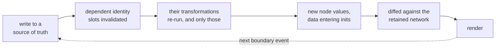

# The data-flow model: nodes, identity, waves

The runtime model everything else in the skill rests on. Read it when a
question is about how SwiftUI recomputes: identity, re-render
frequency, "why did my `@State` reset", "why isn't this updating", a
value a node builds from an input, or when someone argues SwiftUI needs
an architecture bolted on to get unidirectional data flow.

Source: the masterclass, with the mechanics Apple states in *Demystify
SwiftUI* (WWDC21).

## Get the noun right

A `SwiftUI.View` is not a view. It is a node in a network, views and
view modifiers alike, a plain value carrying everything its subtree
will show and do: data, closures, whole child subtrees. Calling it a
view is the wrong noun, and the wrong noun is why so much SwiftUI code
fights the framework instead of using it.

What a node shows but does not own (a `@State` flag, a `@Query` result)
it carries as a dependency, a declared claim on the storage that
supplies the value at creation. The runtime owns the pixels, not the
node.

Describe `View`, `ViewModifier`, `App`, and `Scene` by what they do and
you get four things with four mental models. Ask what they are and they
are one thing: values that are nodes in the reactive dataflow graph,
each carrying a list of dependencies needed to compute its output,
`body`. A `ViewModifier` also receives content as an upstream input.
`Scene` and `App` sit higher in the same graph.

The node-in-a-network claim predates SwiftUI. Flow-Based Programming
(J. Paul Morrison, 1970s) describes a system of independent nodes
communicating only through flows of discrete data packets. Structured
design (Yourdon & Constantine, 1979) names the discipline data
coupling: modules depending on each other only through plain values. It
is the loosest coupling that works. No shared mutable object, no
protocol both sides must know, no hidden channel. SwiftUI already
couples nodes this way. The discipline is refusing to add any other
coupling on top, so every coupling a node has stays legible in its
declaration.

## The execution scheme

- **`body` is a transformation.** Input data in, child nodes out. Not a
  render call.
- **The runtime retains the network, not the nodes.** Identity slots
  hold lifetime metadata and any `@State`. Node values are created and
  discarded each wave. The slots persist.
- **The rhythm is creation, transformation, creation.**
- **Dependencies are recorded by access.** A property wrapper read
  during `body` registers its storage against that slot. An
  `@Observable` object registers each property read on its own, and
  untouched properties create no edge.
- **A read of anything else registers nothing.** A static, a global, a
  property of a class that is not `@Observable`. The node shows what
  its last `body` read, and it follows a later value only by accident,
  when something else runs its `body` again. A wave that re-creates the
  node with equal inputs skips `body`, and the read is not made again.
  A class reference to the same instance is an equal input, whatever
  changed inside the instance. Measured with a static count of models
  built, a row that showed that count and whose one input was the same
  model instance went on showing 1 after three models had been built.
  Its parent showed 3, only because its `body` had run again for
  another reason. So what a node shows comes from a dependency it
  declares, a `let`, a binding, an environment value, a query, or its
  own state.
- **A read of an observed property registers the `body` that is
  running, whatever code makes the read.** A child's `init`, and a
  model's `init` called from it, run inside the parent's `body`, so
  their reads register the parent's `body`. If the same code also
  writes the property, as `count += 1` does, that `body` is registered
  against what it writes. The first run does not loop, since a run's
  registration is in place only when the run ends. Any later run,
  whatever causes it, writes while the previous run's registration
  stands, so it invalidates the `body`, and the run that follows does
  the same. The runs go on for as long as each one repeats the write.
  So code that a `body` runs is written to make no write to an
  observed property it also reads. A write with no read does not loop.
  It is not made there either, since creation is to cause nothing. The
  one thing kept across runs of `body` is a Memo's value. It goes into
  a plain class that the node keeps in `@State`. Writing a plain class
  invalidates nothing, and the value is read by the same `body` that
  stored it, so nothing has to follow it. That is how swift-core-flow's
  `MemoView` works.
- **A write to registered storage invalidates every slot that depends on
  it.** The runtime re-runs those transformations and no others.

The network is rooted at `@main`. `App` and `Scene` are nodes too, with
a `body` transformation and their own `@State`, invalidated the same
way. There is no layer above the network. App-wide state is state in
the root node, flowing down like any other.



A spreadsheet is the same scheme. Each formula records the cells it
reads, and one edit recomputes the formulas downstream and no others.

| Spreadsheet | SwiftUI |
|---|---|
| formula | `body` |
| cell | identity slot |
| edit | a source-of-truth write |
| recalculation | a wave |

## Identity

Identity is structural by default. A slot is keyed by type and position
among siblings, not by any value the node carries. `.id()` overrides
this with a custom key.

- Same identity reuses the slot and keeps its `@State`.
- Changed identity tears down the old slot and its `@State`, then builds
  a new one.
- Flipping an `if` swaps identities. That is a teardown, not an update.

Positional means literal. Hand-write three rows and swap the first two,
and each keeps the `@State` of its position, not of its book.
`.id(book.id)` re-keys to the book instead, so `@State` travels with it.
That is what `ForEach(books, id: \.id)` does for you.

```swift
// wrong: index as identity. Inserting at the front re-keys every row below it.
ForEach(books.indices, id: \.self) { index in
    BookRow(book: books[index])
}

// wrong: an editable field as identity. Editing a title is a teardown, not an update,
// and two equal titles collide into one slot.
ForEach(books, id: \.title) { book in
    BookRow(book: book)
}

// right: stable, unique among siblings, independent of position and of anything editable.
ForEach(books, id: \.id) { book in // the key named at the call site
    BookRow(book: book)
}
```

`id: \.self` is right only for a collection of distinct, immutable
values that do not reorder, such as a fixed set of enum cases.

Re-keying a subtree with `.id()` is how you ask for a teardown: a clean
form after a submit, a fresh editor per selected item. Do not use it to
force a refresh. If a view is not updating, a dependency is missing,
and re-keying hides the bug behind a rebuild that also throws away every
`@State` below it.

When a row's `@State` resets at random or sticks to the wrong item, the
answer is almost always identity.

The same trap has a value-shaped form, `@State` seeded from an input,
with `.id(seed)` as its usual repair. The next section has it.

## A value built from an input

A node is handed an input and shows something that starts from it. One
kind is built from the input, as a model is made from an id. The other
is a copy the user then edits, as an editor's field starts with the
item's title. Two requirements hold together.

1. **It follows the input.** When the parent hands a new input, the
   node shows what is built from the new one.
2. **It is kept while the input does not change.** A wave that leaves
   the input alone builds nothing and keeps the same instance.

A design that fails the first has a second source of truth, a copy that
stopped following. One that fails the second builds on every wave and
throws away what it built. The second counts when the built thing
holds state of its own or costs something to build. A cheap value that
holds nothing is a computed property, built each wave, and only the
first requirement applies to it. A copy the user edits follows by
being written again when the parent hands a different item. It is not
written again while that item is being edited, which is what makes it
a draft.

`@State` built in an `init` (`_doubler = State(wrappedValue:
Doubler(seed: seed))`) fails both. The `init` runs at every creation
and builds a `Doubler` each time. The slot keeps the first one and
every later one is thrown away, so the node shows what was built from
the first `seed` from then on. The input is the parent's, so the kept
`Doubler` is the second source of truth.

A seed made lazy removes the waste and keeps the staleness. A lazy
seed, an autoclosure or a wrapper that defers the build, builds once,
and what it builds is still made from the first input.

The usual repairs keep the copy and have the runtime bring it back in
step afterwards. None of them removes the second source of truth, and
the method uses none of them for this.

- `.id(seed)` follows the input by tearing the subtree down, and every
  `@State` below goes with it.
- `.onChange(of: seed)` writes the copy again one wave late. `body`
  runs once with the new input beside the old copy, and then again.
- `.task(id: seed)` does the same. It also runs at appearance, so with
  the seed still in the `init` it builds a second value for the first
  input.

A `.task(id:)` that makes a boundary call is not this mistake. A
load's result is new data and not the input again. It is this repair
when what it writes into the node's state is a copy of the input, or
something built from the input with no boundary call. Where a load is
started is another rule (`shell-core.md`, "Who owns the load").

There are two ways to keep one source of truth. The choice between
them is by who knows how to build the thing, and the first is the
default.

- **Up. The event builds it.** This is the way when the parent knows
  how to build the thing. The child's `init` runs at every creation,
  and the child enters the graph once. When it enters after launch, a
  write puts it there, the flag that presents a sheet, the selection
  that mounts a detail. The handler that makes that write, or the one
  that changes the input, also builds the value, into `@State` of the
  parent, the node that mounts the child. The child receives it as a
  `let` when it only reads it and as a binding when it writes it. A
  child present from launch gets its first value from the initial
  value of that `@State` in the parent. This is the lift, and it needs
  no machinery. So where to run something when a node first appears is
  not a question about the node. It runs in the action that puts the
  node in the graph. A load is included. The action starts it, as a
  task the node that handles the action holds (`shell-core.md`, "Who
  owns the load").
  ```swift
  Button("Edit") {
      title = book.title      // the tap that mounts the editor fills it
      isEditing = true
  }
  .sheet(isPresented: $isEditing) { EditBook(title: $title) }
  ```
  A draft that starts from an item is this case. Its first value is
  written by the tap, above the form. A draft that starts empty needs
  no seed and stays where it is edited.
- **Down. The child derives it.** This is the way when the built thing
  is the child's own detail, a type the parent has no reason to name.
  The parent hands only the input and the child builds from it. A
  cheap value that holds nothing is a computed property. One that is
  to be kept is swift-core-flow's `MemoView(Doubler(seed: seed),
  dependencies: [seed]) { doubler in … }`. The first argument is
  deferred, an autoclosure. It runs at the first `body` and again only
  when a listed dependency has changed. So the value is built from the
  current input, the same instance is kept across unrelated waves, and
  a new one is built when the input changes. It is React's `useMemo`
  as a view. It has two limits. A changed dependency replaces the
  whole value, so state that is to survive a change of the input does
  not belong in it. That state is `@State` of the view that hosts the
  `MemoView`, which the Memo leaves alone. And when the build reads an
  input that `dependencies:` leaves out, a change of that input is not
  followed. `QueryView` is the same over a `Query` (`shell-core.md`).

A binding to the parent's own input, handed to the child beside a copy
the child builds, is not a third way. A binding shares a value. It
does not rebuild what was built from it.

Each row below was measured as a UI test. The input starts at 1. The
script is one unrelated write in the parent and then one write of the
input, to 2.

| The child's value is held by | It shows the value built from | Values built |
|---|---|---|
| `@State` built in an `init` | 1, stale | 3 |
| a lazy seed | 1, stale | 1 |
| `@State` built in an `init`, under `.id(input)` | 2, and the child's own `@State` is reset | 3 |
| the parent's event, handed down | 2 | 2 |
| a Memo keyed by the input | 2, and the child's own `@State` is kept | 2 |

[LazyStateAntipattern](https://github.com/sisoje/LazyStateAntipattern)
is the public form of the first, second, and last rows, the second
with Point-Free's `@LazyState`. A count of builds records what
SwiftUI does. An app's test does not count builds. It reads the log
(`testing.md`).

### The common forms, and what replaces each

The same mistake is written many ways, and it has one cause. The view
struct is taken for the view on screen. The view on screen appears and
goes, and the struct is created every wave. In the rows that build in
an `init`, the struct's creation is given a job that belongs to a
lifetime. A class instance and a query are made once and kept, and a
view's `init` runs every wave. In the rows with `.onAppear`,
`.onChange`, `.id()`, and `.task`, the lifecycle of the view on screen
is asked to make up for that, or to start the app's work. Every row
was measured, the last with a push and a pop and with a change of
tab, the others with the script above.

| The form | What it does | What replaces it |
|---|---|---|
| `_model = State(wrappedValue: Model(id: id))` in an `init` | a build at every creation, the first kept | the event builds it in the parent, or a Memo in the child |
| `self.model = Model(id: id)` in an `init`, the declaration left without an initial value | the same, 3 built and the first shown | the same |
| the build made lazy, a wrapper that takes a closure | one build, the first kept | the same |
| `.onAppear { model = Model(id: id) }` over an optional `@State` | `body` runs first with nothing to show, and then the first is kept | the same, and the optional is no longer needed |
| `.onChange(of: id) { model = Model(id: $1) }` added to one of the above | follows one wave late | removed together with the seed |
| `.id(id)` on the child | follows by teardown, and the child's own `@State` is lost | removed together with the seed. `.id()` is for a teardown that is wanted |
| `_books = Query(filter: …)` in a child's `init` | follows the input, and a query is built at every creation | `QueryView` with `dependencies:` (`shell-core.md`) |
| `.task { await load() }` or `.onAppear { Task { await load() } }` on a node an action mounts | the load runs again each time the view on screen reappears, when a screen pushed over it is popped and when the user comes back from another tab. The second form is also a `Task` nobody holds | the action that mounts the node starts the load, as a task the node that handles the action holds (`shell-core.md`, "Who owns the load") |

The second row is what Apple's migration note for SDK 27 gives for the
compile error the `@State` macro raises on a state assigned in `init`.
The note says to drop the initial value at the declaration and assign
the property only in `init`. That removes the error and keeps the
seed. State that takes its first value from an initializer argument
belongs to the node that supplies the argument.

## Anatomy of a node

Every line in a node is flow in, a self-loop, or flow out.

```swift
struct BookRow: View {
    let title: String                     // in: at creation
    let author: String                    // in: at creation
    @State private var isFavorite = false // self-loop, not an edge
    var body: some View { ... }           // out: creates the children
}
```

**In, from the caller, at creation.** Plain values. A `Binding` is data
too, a struct wrapping `get: () -> Value` and `set: (Value) -> Void`
that an ancestor built. The setter usually ends in that ancestor's
storage; whatever else it does is the ancestor's decision. It is still
a value handed downward. The backward part was baked into the closures before this
node saw them. A `@ViewBuilder` subtree is a value. Closures are
values. `onSubmit` is data until called.

**In, from the runtime, at creation.** `@State` reads the node's own
storage, a self-loop. A write now is the value read at the next
creation. Tapping the star writes `isFavorite`, invalidating the slot,
and the next `BookRow` creation reads `true`. The storage lives in the
slot, which persists across waves as node values do not. So `= false`
is not an assignment but an initial value, used once, when the slot is
established. On a `private` `@State` the expression is not evaluated at
creation. On one that is not private it is evaluated at every creation
and used only the first time. The deferral saves the build at every
creation, a heap allocation each wave when the value is a class. It
does not make creation a place to start a lifetime. Hence
`private`: the runtime owns that storage, not a caller. A plain
`private let` or `var` would be state outside the flow. swift-core-flow
makes that a compile error in both directions. `private` marks a source
of truth and nothing else, so a source-of-truth wrapper declared
non-private is rejected (a caller cannot supply one; `@Binding` is for
that), and a private property with no wrapper is rejected too.

**Out, to the children, at creation.** `body`'s return value is the
children created, with data entering their inits. This is also why a
view `init` may only plumb data.

## Boundary events

In, self-loop, out. That is the whole of flow. The rest happens at a
node's edges.

A binding write runs the setter an ancestor built. An action call
carries a plain payload out of the node. Neither is data flow.
Parameters move on every call, and movement is not the criterion.

The criterion is whether the event changes a source of truth, storage
some node reads.

| Event | Source of truth changed? |
|---|---|
| A binding write whose setter chain ends in a source of truth | Yes. The next wave follows, through every node reading that storage |
| `.constant(…)` write | No. The degenerate case, a write that changes nothing |
| `onDelete` removing a `Book` from the `ModelContext` | Yes. The context's change notification re-runs `@Query`'s fetch at once, invalidating the dependent slot. Disk persistence is a separate step the runtime schedules on its own. No explicit `save()` is needed for the view to update |
| A fire-and-forget network request | No. The payload left the data-flow world. A response re-enters only as a later write into some source of truth |

Most waves do not reshape. Same structure, new values. The parent
re-creates the child value either way, and the runtime compares it
against the retained one and skips the child's `body` when the two
match. Reshaping, a changed type or a changed `.id()`, is rare. Either
way the loop closes through storage and re-creation, not through a
backward edge.

Data coupling holds for actions too. The node does not depend on what
the call does.

> A node's whole observable behavior is the children it creates and its
> boundary events: the mutations it performs, the calls it makes, their
> payloads.

Nothing else about a node is observable. That is what makes it
testable. `testing.md` uses the ordered record of boundary events as
the assertion.

## Slices want structural types

A node is still coupled to whatever type its in-parameters name. Shrink
that too. `BookRow` takes two fields, not a `Book`.

```swift
// default: separate parameters, no model type in the signature
struct BookRow: View {
    let title: String
    let author: String
}
```

Sometimes a slice has to travel as one value, as a helper's return, a
list element, or a closure parameter, and then it needs a type. Nominal
types scale badly here. Three views drawing overlapping slices of a
five-field model force three named structs, or one struct that
recouples each view to fields it does not read. Swift's tuples are
structural. Same labels and types mean the same type, so a slice is its
fields, with no name to mint:

```swift
func bookRow(_ book: (title: String, author: String)) -> some View { ... }
// a Book, a search result, a decoded JSON row: any caller with that shape fits
```

The trade is that tuples cannot conform to protocols. No `Hashable`,
no custom `Equatable`, no `Codable`. Reach for a struct the moment a
slice needs any of those. A `ForEach` is not that moment; `id:` keys a
tuple as well as a struct.

Behavior bundles the same way (Wlaschin's capability-based design).
Hand a consumer the functions it may call, as values, not the whole
object or a protocol. `(save: (Book) -> Void, delete: (Book) -> Void)`
grants those two verbs, and the consumer has nothing else to couple to.

swift-core-flow mechanizes both halves. `#pick(from: book, \.title,
\.author)` projects fields from one or more sources into one tuple.
Several key paths return a positional tuple; one returns the bare
value. `@Capability` on a type or an extension bundles its computed
properties and methods into one `Capability` tuple and a `capability`
property, so a consumer receives the operations and values it is
entitled to, with no protocol to conform to. `@Flowable` writes a type's
memberwise `init` at its own access level and names its construction
inputs as a labelled tuple, `InFlow`, with `makeFlow(_:)` building the
type from any structurally compatible tuple. The shape itself is the
type, and no struct is minted per field combination.

This does not license bundling. A tuple of unrelated screen state is a
`ViewState` umbrella minus the name. The test is whether these fields
would still travel together if the screen split in two. A row's `title`
and `author`, read off one record, pass. A form's fields do not. Each
is its own `@State`, handed anywhere as a binding, and the model
exists only when Save assembles it. A search screen's `query`,
`results`, and `scrollTarget` fail too. Nothing but the screen relates
them, so they stay separate `@State`s. Bundle what one record or one
call already groups, not what one screen shows. Today's screen is
tomorrow's two.

## Wrappers: sources, references, machinery

Tuples and capability records cover what a caller hands in explicitly.
The rest reaches a node through property wrappers, which divide in
three.

Sources of truth are `@State`, `@AppStorage`, and `@SceneStorage`. What
they hold is a plain value, a `Bool`, a `String`, and the node owns it.
Data can move. It can be handed in, captured, asserted on.

References are `@Binding`, `@Environment`, and `@Query`. None holds
state of its own. A query is a filtered read of the store the root
opened, and arrives as the array it delivers. A binding is a `get`/`set` pair an ancestor built and arrives at
the initializer. An environment value is a value an ancestor
set with `.environment(...)` and arrives without a constructor
argument. That is the only difference between them, and it is a
difference of spelling, not of kind. All are data in. A scenario
replaces the binding with a literal binding, the environment value
with `.environment(...)`, and the query with a canned array or a
seeded container.

UI-runtime machinery is `@GestureState` (a live gesture's lifecycle),
`@FocusState` (the focus system), `@Namespace` (view identity), and
`@ScaledMetric` (display metrics). None hold data a caller could
supply. There is no `BookRow(gesture: .inProgress)` the way there is
`BookRow(title: "Dune")`. A gesture in progress exists only inside a
running render pipeline, not as a value in a caller's hand.

What the environment read means for a core is in `shell-core.md`.

All three groups, and any custom `DynamicProperty`, resolve only inside a
`View`, `App`, `Scene`, `ViewModifier`, or another `DynamicProperty`.
The one exception is `@Binding`. It is a plain `get`/`set` pair, so it
works in any struct. Inside a class the others are not installed.
`@State` keeps its initial value and drops the write. `@AppStorage`
writes to the defaults and does not follow them. Nothing there drives
a wave.
That is the single most common bug in MVVM-in-SwiftUI code, and a
direct consequence of putting state where it does not belong.

## Unidirectional flow was not missing

The ViewModel and reducer reflex assumes SwiftUI needs an architecture
bolted on to get one-way data flow. But one-way was not about
direction.

- Data flows down into inits.
- Preferences flow up, as children publish `PreferenceKey` values an
  ancestor accumulates.

Both are unidirectional, because both terminate. A flow starts at a
write or a creation and ends in a source of truth, or in the nodes
created reading it. No after-effect rides the wave.

### What breaks it: feedback cascades

Not another wave. Every tap and keystroke spawns one. A feedback cycle
is a wave whose side effects schedule the next wave, with no new
boundary event between them.

```swift
// one keystroke, three waves
.onChange(of: query)   { _, new in results = search(new) }   // wave 1 to wave 2
.onChange(of: results) { _, new in isEmpty = new.isEmpty }   // wave 2 to wave 3
```

Nothing in either node says what `isEmpty` depends on. The transition is
spread across two modifiers that do not mention each other. It emerges
from the cascade instead of living in any node. That, not data moving
up the tree, is the violation.

The fixes, in order of preference:

1. **Derive instead of store.** `results` and `isEmpty` are functions of
   `query`. Make them computed properties, not `@State`. Zero extra
   waves, and the dependency is written down in one place.
   ```swift
   private var results: [Result] { search(query) }
   private var isEmpty: Bool { results.isEmpty }
   ```
   Which screen shows is a derivation too. `if token == nil { Login() }`
   is a projection of the token, not a route to keep in sync. The nil
   write is the logout.
2. **Do the whole transition in one boundary event.** If the work is
   async, one task writes every affected piece of state once, started
   by the write and held by the node. Not a chain of handlers each
   writing one field. When the write
   arrives through a binding the owner hands down, the owner's setter is
   that event. Build the `Binding` by hand and let the effect ride the
   write. `.onChange` on state the node owns is one render late and
   cannot tell what changed or why.
3. **Only then `.onChange`**, for a single, terminal reaction to a value
   you do not own: scroll-to, haptic, analytics, dismissing a sheet. One
   hop, and no second `.onChange` listening to what the first wrote. A
   reaction that writes the node's own state from an input it was
   handed is not terminal. It is the repair of a seeded copy ("A value
   built from an input", above).

Review heuristic: two `.onChange` modifiers where the second observes
state the first writes is a defect. Collapse them.

### The view is the reducer

Redux-style architectures (Elm, MVI, TCA) do not add termination. A
reducer coexists with `.onChange` cascades. What a reducer adds is a
policy for boundary events. Every event becomes an action, funneled
through one function, before writing a source of truth. Below the
write, nothing changes: invalidation, wave, render, as before.

Centralizing transitions is a coordination policy for large teams, not a
data flow correction. Gained: one place answering "where can `isLoading`
become true?", and an action log. Paid: machinery on every interaction
(action enum, reducer case, effect) where a closure writing storage
would do.

```swift
@State private var username = ""

Button("Clear") {
    username = ""
}   // the transition, beside its state
```

Each state transition lives in the node that owns the storage, next to
the UI that triggers it. Where is the reducer, where is the ViewModel,
where does the logic live: every one of those questions assumes the
view is a template waiting for something else to animate it. It is not.
It is a node. Data in at creation, boundary events out, nothing else.

## Making the wave cheaper

The wave re-runs the transformations whose inputs changed, so cost is a
function of how many slots depend on a piece of storage and how much
each `body` does. In order of leverage:

1. **Narrow the dependency.** A node that takes `title: String` is
   invalidated by title changes. One that takes `book: Book` is
   invalidated by every field. Slices are a performance rule as much as
   a coupling rule.
2. **Own storage as low as possible.** `@State` at a flow's root
   invalidates the whole flow. `@State` on the row invalidates the row.
3. **Read `@Observable` properties where you use them.** Observation
   records each property read, so reading one field deep in the tree
   creates one edge there. Reading it in the parent and passing the
   value puts the edge on the parent instead. Neither is wrong. Know
   which one you built.
4. **Let laziness do the work.** `List` and the lazy stacks create child
   values only near the viewport. A `VStack` in a `ScrollView` creates
   all of them, every wave.

Do not tune by counting `body` runs. Evaluation counts shift with
SwiftUI internals and with the debugger attached. `body` is cheap by
design, and running it twice is not a bug. Measure with Instruments'
SwiftUI template and act on what is slow. The same reasoning is why
`testing.md` does not assert "body was evaluated N times".

## The rules under their older names

SwiftUI is pure data flow. Nothing but values couples its nodes. A
boundary event, a write or a call, is not flow, and it comes back into
the flow only through a source of truth ("Boundary events", above).
What SwiftUI adds to a dataflow network is that any view may introduce
a source of truth, `@State` or a storage wrapper, so new data enters
the flow at that node and not only from above. The API's words are
still object words, `View`, `onAppear`, `task`, lifecycle, and each
rule in this skill first has to un-say a word that carries the UIKit
model. The literature below does not have those words. When a rule
here looks arbitrary, read it under its older name.

| The rule here | Its older name | Source |
|---|---|---|
| A node is a transformation, coupled to the others only by the values that flow | a process in a dataflow network | Kahn 1974; Wadge and Ashcroft 1985; Morrison |
| Data coupling, the loosest coupling that works | data coupling | Yourdon and Constantine 1979 |
| The map, a node, an arrow, a dependency's cylinder, and what is outside the app | a data flow diagram, a process, a data flow, a data store, and a source or sink outside the system | DeMarco 1978 |
| Hide the how, not the state | information hiding | Parnas 1972 |
| A source of truth is state. What can be computed from it is computed, and a seed is a stored copy of it | essential state against accidental state | Moseley and Marks 2006 |
| A wave re-runs the transformations whose inputs changed, and no others | change propagation | Acar 2005 |
| What is built from an input follows the input and is kept while the input does not change. A Memo | a build that is correct and minimal, a step run again only when an input it depends on has changed | Mokhov, Mitchell, and Peyton Jones 2018 |
| State drives the node, and a write or a call is the event | a "behavior", that literature's word for a value over time, against an "event", a discrete occurrence. Its behavior is this skill's state, not this skill's closures | Elliott and Hudak 1997 |
| The network is reactive, so the nodes do not have to be | a reactive system against a transformational one | Harel and Pnueli 1985 |
| The action that puts a node in the graph starts the node's work, not `.task` on appearance | an output on the transition, a Mealy machine, not on the state, a Moore machine. In a statechart an event triggers the transition | Mealy 1955; Moore 1956; Harel 1987 |
| The core is pure, and the I/O is at the edge | values as the boundary, a functional core in an imperative shell | Bernhardt 2012; Wlaschin |

## Where the model came from

- Gilles Kahn, "The Semantics of a Simple Language for Parallel
  Programming" (IFIP Congress 74, 1974), processes that communicate
  only through streams of values
- William Wadge & Edward Ashcroft, *Lucid, the Dataflow Programming
  Language* (Academic Press, 1985)
- J. Paul Morrison, [Flow-Based Programming](https://jpaulmorrison.com/fbp/) (2nd ed. 2010)
- Tom DeMarco, *Structured Analysis and System Specification* (Yourdon
  Press, 1978), the data flow diagram
- Edward Yourdon & Larry Constantine, *Structured Design* (1979), the coupling taxonomy
- David Parnas, [On the Criteria To Be Used in Decomposing Systems into Modules](https://doi.org/10.1145/361598.361623)
  (CACM, 1972)
- George Mealy, "A Method for Synthesizing Sequential Circuits" (Bell
  System Technical Journal, 1955); Edward Moore, "Gedanken-experiments
  on Sequential Machines" (Automata Studies, 1956)
- David Harel & Amir Pnueli, [On the Development of Reactive Systems](https://doi.org/10.1007/978-3-642-82453-1_17)
  (1985); David Harel, [Statecharts: A Visual Formalism for Complex Systems](https://doi.org/10.1016/0167-6423(87)90035-9)
  (Science of Computer Programming, 1987)
- Conal Elliott & Paul Hudak, [Functional Reactive Animation](http://conal.net/papers/icfp97/) (ICFP 1997)
- Andrey Mokhov, Neil Mitchell & Simon Peyton Jones, [Build Systems à la Carte](https://www.microsoft.com/en-us/research/publication/build-systems-la-carte/)
  (ICFP 2018)
- Gary Bernhardt, [Boundaries](https://www.destroyallsoftware.com/talks/boundaries) (2012)
- Ian Cooper, [Hustle and Flow](https://www.youtube.com/watch?v=p0bKMuBdpL8) (NDC Porto 2022);
  [Succeeding at Reactive Architecture](https://www.youtube.com/watch?v=YyWKczrfxW4) (NDC London 2023)
- Ben Moseley & Peter Marks, [Out of the Tar Pit](https://curtclifton.net/papers/MoseleyMarks06a.pdf) (2006)
- Umut Acar, [Self-Adjusting Computation](https://www.cs.cmu.edu/~rwh/students/acar.pdf) (CMU 2005);
  Jane Street, [Introducing Incremental](https://blog.janestreet.com/introducing-incremental/)
- Apple, [Demystify SwiftUI](https://developer.apple.com/videos/play/wwdc2021/10022/) (WWDC21);
  [Data Essentials in SwiftUI](https://developer.apple.com/videos/play/wwdc2020/10040/) (WWDC20)
- React, [Thinking in React](https://react.dev/learn/thinking-in-react);
  Elm, [The Elm Architecture](https://guide.elm-lang.org/architecture/)
