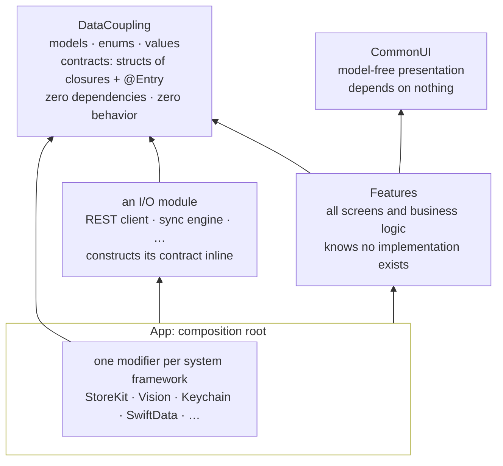

# The data coupling layer: contracts, the module graph, the root

Read this when adding a service, a dependency, an environment value, or
a package; when laying out an app's modules; or when someone reaches for
a protocol, a DI container, or a `.live` static.

Sources: the method article (the layer, flow not injection), the
masterclass (capabilities as values), Wlaschin's taxonomy, and the
module rules distilled from a shipped data-coupled app, written here in
general form.

## The layer

A module that holds state couples every importer to what it holds. A
stateless module is algorithms and cores, importable anywhere, tested
alone, owned by anyone. The state sits at the top, in the app that
composes the modules.

What the modules share is one more module, the data coupling layer. It
is free of behavior: the models, the closure signatures, and the
`EnvironmentValues` entries that propagate them. The composition root
constructs the implementations, features consume them, and the two meet
nowhere but in that layer's types. For the shelf that is `Book`,
`LibraryService`, and the `@Entry`.

```swift
struct Book: Identifiable, Equatable {
    let id: String
    let title: String
    let author: String
}

struct LibraryService {
    var fetch: (_ byAuthor: Bool) async throws -> [Book] = { _ in [] }
    var save: ([Book]) async throws -> Void = { _ in }
}

extension EnvironmentValues {
    @Entry var library = LibraryService()     // the default is the minimal no-op
}
```

`id` is an initializer argument, never generated inside the model. Two
literals with the same id are equal, so a fixture is a literal and
needs no `static let` to hold identity across waves.

The method article writes the same contract with `let` members marked
`@Sendable` and the default spelled out in the `@Entry`. That form is
equivalent. The defaulted initializer makes the no-op `.init()`, which
is the form this skill uses.

Constantine ranked coupling fifty years ago. Data coupling is the
weakest, best kind there is. Every iOS "architecture" couples modules
through protocols, DI containers, or shared objects. Here modules share
one thing, a package of pure data. Data is the abstraction.

### What belongs in it

- **Models, enums, projection values.** Pure data: stored properties
  and initializers, with defaults. No computed properties, no methods.
  Lift every computed member out as a pure extension in the feature
  layer (`Book+Domain.swift`). Pure, side-effect-free logic belongs in
  the feature packages. Only I/O is isolated to the app.
- **Classes only when they earn it**, and even then as pure data.
  Default to value types. Reach for a class (usually `@Observable`) when
  it pays for itself: a lifecycle a struct cannot own (a custom source
  of truth, a system bridge, resources that need cleanup); clean
  decomposition, where `@Bindable` hands children real
  `$model.property` bindings; or per-element performance, where model
  classes in a collection are observed one by one. `deinit` is the one
  behavior allowed on data, and only to release what the object holds:
  cancel a task, stop a manager, tear down a subscription.
- **Contracts.** The service signatures, as structs of closures (next
  section), each with its `@Entry`. A contract lives in the layer even
  when its implementation lives in some other package. Folders slice by
  what the closure struct is, never by which package implements it.
- **Only shared types.** A type earns its place by crossing a module
  boundary, either referenced by another type in the layer or used by
  more than one feature or module. A model or enum one feature uses
  stays local to that feature. Promoting it bloats the package
  everything depends on and manufactures false coupling. When in doubt,
  grep its usages first.
- **No unnecessary conformances, even on data.** Drop `Identifiable`,
  `Sendable`, `Codable`, and `CaseIterable` unless something concrete
  needs them. `ForEach(books, id: \.id)` needs no conformance;
  `Identifiable` is for the APIs that demand it, such as `.sheet(item:)`.
  Prove necessity by building, never by guessing.
- **Defaulted initializers, not factories.** Give the initializer default
  parameter values instead of `make…` helpers, so the no-op default
  collapses to `.init()`. Do not add members "just in case".

## Contracts: behavior as data

A capability is a closure, or a struct of closures. Closures are
first-class values. They can be passed, stored, composed, and
substituted. Unlike classes they carry no hidden state. Unlike
protocols they need no conformance. Three shapes:

```swift
// one capability
let fetchUser: (UserID) async throws -> User

// grouped capabilities that travel together: a contract
struct UserService {
    var fetch:  (UserID) async throws -> User? = { _ in nil }
    var save:   (User)   async throws -> Void = { _ in }
    var delete: (UserID) async throws -> Void = { _ in }
}

// a local bundle, granted to one consumer, with no type to mint
let actions: (save: (Book) -> Void, delete: (Book) -> Void)
```

Pick the tuple when the bundle is used by one or two call sites in the
same module. Promote it to a named struct when it crosses a module
boundary, is reused, or needs a conformance, since tuples cannot
conform to anything. The call sites keep the same labels.

swift-core-flow's `@Capability` generates that tuple from a type or an
extension. Every eligible computed property and method is bundled into
one `Capability` typealias and a `capability` property, so a consumer
is handed the operations it may call without a protocol it must conform
to. And since Swift synthesizes only an internal memberwise init, every
public data struct in the layer needs a `public init`. `@Flowable`
writes it at the type's access level, defaults carried through, closure
fields `@escaping`.

A contract's members are closures, lets, or bindings. A struct of
`@Binding`s is a contract too, such as a settings value the root builds
over its own `@AppStorage` properties, so features read one value from
the environment instead of each materializing the key.

The consumer dictates the signature, never the implementation that will
satisfy it. The core constructs the model and hands it over (`try await
save(book)`). The closure is `async` or `throws` because the I/O can
fail. `async` is the I/O marker. Every contract closure carries its
effects in its type, and pure logic has none.

The default is the minimal no-op. An environment value's default is
`.init()` with do-nothing closures, never a `static let live`. The default is what previews and tests get. It already stubs every shape
of I/O, and a test overrides only the closure it spies on. A closure that
must return returns nothing: an empty collection, or `nil` through an
optional result, which is the honest shape for a fetch that may find
nothing. Never a blank value that looks real, and never a trap.

Mark closure types `@Sendable` only when a closure crosses an isolation
boundary. Under a main-actor default isolation most never do. Do not
add it to paper over an isolation error.

### Why this beats protocol plus class

| Concern | Protocol plus class | Struct of closures |
|---|---|---|
| Substitution | a conforming type | construct with new closures |
| Mocking in tests | subclass or mock framework | pass a logging closure |
| Composition | wrapper types, decorators | wrap a closure in a closure |
| Partial override | subclass and override one method | construct with some reused, some replaced |
| Existential cost | boxing | value semantics |
| Lines of code | N | about N/3 |

Cross-cutting concerns compose by closure wrapping. A logged or
retrying variant is a new value built from the old one, with only the
wrapped member changed. Reach for a protocol only when the compiler
must discover conformance across a module boundary (a plugin API
external callers implement), when Objective-C interop requires a class,
or when an API has ten or more methods with shared default
implementations. For the rest, a handful of closures with one live
implementation and test variants, the struct wins.

## The module graph



Read the arrows. Every dependency points at data. Features and the I/O
modules never meet at compile time. A sync engine consumes the REST
contract as a value read from the environment, not the package that
implements it. What you will not find: a feature importing an I/O
module, an I/O module importing another, a protocol, a container, a
mock target. I/O modules meet only through data, wired by the
environment at runtime.

- **Features** hold all screens and feature logic plus a pure shared
  layer: side-effect-free calculators, extensions on the layer's types,
  pure components. SwiftData reads in shells and system bridges
  (`UIViewControllerRepresentable`) are allowed. Ambient I/O (system
  frameworks, files, the network) is not. That goes through a contract.
- **Model-free presentation** (`CommonUI`) never depends on the data
  layer. Design-system pieces take values, not models.
- **An I/O module** depends on the data layer and on whatever transport
  it needs. Its root modifier constructs the live contract inline. Its logic
  is plain functions taking those dependencies as parameters.
- **The app** is a pure composition shell: `@main`, the model container,
  the chain of modifiers that set the live values. The single public
  view of the feature package is
  its root. Everything else in it is internal.

The modifiers need not be packages. Each is already a module in
everything but name, one file, one system framework, one contract, and
promoting one to a package changes no import.

## The composition root

Every app has one, `@main`, where the live values are set once. Keep it
flat and inline.

- **The root builds the live value inline, where it sets it.** The
  modifier that sets a value is the one place that already holds the
  implementation's
  inputs: a base URL, a transport closure, `\.modelContext`, a contract
  set upstream. Implementation logic the closures call is plain
  `internal` functions taking those as parameters.
- **One modifier per dependency, one system framework per file.**
  StoreKit, Vision, LocalAuthentication, Security, and UserNotifications
  each appear in one file in the codebase. A dependency may bundle
  related contracts and carry its implementation details privately.
- **The chain is applied inline at the root**, with no umbrella wrapper.
  It is used once, and it reads top to bottom. Ordering matters only
  where one modifier reads a value another set. The reader sits
  inside.
- **These modifiers are not views.** They are the points where the root
  sets values into the environment, and they stay in the app forever.
- **Previews never touch real storage.** A preview must not set the real
  storage-backed service or write `UserDefaults`. That is root plumbing,
  and it breaks previews with no error. Lean on the default. A specific
  value comes from `@Previewable @State` bound into a defaulted
  initializer.

### No `.live`, `.preview`, `.unimplemented`, and no `+Live` files

Never attach an implementation to a contract type by extension
(`extension LibraryService { static func live(baseURL:) }` in a
`LibraryService+Live.swift`). It makes the implementation look like
part of the contract, scatters the type across packages, and forces a
jump from the modifier that sets the value to another file to read the
wiring. The no-op
default already serves previews and tests, and a scenario builds the
logger. Corollary: if a value can be created with no inputs, it does
not belong in the environment.

## Flow, not injection

Dependency injection is an OOP patch. Objects fuse state and behavior,
so before anything can run an object graph must be assembled with
constructors, containers, and resolvers. That graph is invisible,
global, and frozen at assembly time, and every screen depends on it.

Here there is no object graph, so there is nothing to inject into. A
capability is a value, and it travels the same reactive dataflow graph
as every other value: down the view tree, through `@Environment`, like
state. Nothing has a constructor waiting to be filled. The root's modifiers
set a value into the flow.

`@Entry` drops a value straight down. For events that must travel up,
such as a deeplink any node may emit and the mounted nodes handle,
`@FlowUp var deeplink: (URL) -> Void` in the same `EnvironmentValues`
extension declares a typed flow. `.collectFlow(\.deeplink)` goes on the
accumulator at the top of the subtree, `.onFlow(\.deeplink) { … }` on
each listener, and `@Environment(\.deeplink)` hands any node below a
real closure that calls every registered listener. It is scoped to the
subtree under its accumulator. Unmounting unregisters, and nothing
leaks. One accumulator at the app root for everything is the global bus
this avoids. Name a flow for what the caller means. A verb is a command
whose listeners are the implementation (`deeplink`). A past-tense
clause is a notification that a service's verb already happened
(`logoutHappened`). Never name it after the reaction.

| OOP dependency injection | dependency flow |
|---|---|
| assemble the graph before runtime | values flow at runtime, continuously |
| one global wiring | replaced below the root in a preview or a scenario |
| swap = reconfigure the container | swap = flow a different value |
| mock = protocol plus mock class | mock = `.init()` |
| a change re-resolves the graph | a change recomputes dependent views, like any state |

> State flows down. Events flow up. Capabilities flow down too.
> A dependency is just state.

Wlaschin's six approaches, and which this architecture uses:

| Approach | Verdict | Here |
|---|---|---|
| dependency retention | scripts only | none |
| dependency rejection | best: pure core, I/O at the edges | calculators and pure extensions, data in and data out, not even a closure |
| dependency parameterization | when the core needs a capability | the structs of closures, except the parameters are not hand-threaded. They flow |
| dependency injection (OO) | when forced | rejected. No constructor anywhere waits to be filled |
| reader monad, interpretation | too clever | none |

Reject what can be rejected. Parameterize the rest. Let the parameters
flow. Flow is the SwiftUI-native upgrade over hand-threading that F#
could not express.

Visibility was never the coupling. Apple exposes everything to every
feature through the environment. Seeing a capability couples nothing.
Consuming it does. Hiding dependencies mattered in OO because a
dependency was a stateful reference, and seeing one meant being able to
corrupt it. A closure can only be called.

## Do not

- **Property-wrapped dependencies inside a class.** `@Environment`,
  `@AppStorage`, `@Query`, and `@FocusState` resolve only inside a
  `DynamicProperty` context. In a class they do nothing and raise no
  error.
- **A service locator or singleton** (`Services.shared`). Untestable, no
  override points, shared mutable state. A value in the environment can
  be overridden at any level of the tree and needs no framework.
- **A protocol per dependency by default**, with `LiveX` and `MockX`
  classes behind it. The struct of closures gives the same
  substitutability, and the test variant is one more value.
- **An `@Observable` service class.** State stays in views. Behavior
  stays in closures.
- **A dependency that can be made with no inputs.** It is a constant.
  Use it directly.

## Checklist

- [ ] Every shared type is pure data. Computed members are extensions in
      the feature layer.
- [ ] Every contract is a struct of closures, lets, or bindings with a
      defaulted initializer and an `@Entry` whose default is `.init()`.
- [ ] Every `async` and `throws` lives in a contract closure. Pure logic
      has none.
- [ ] Features and I/O modules depend on the data layer and never on
      each other. Presentation depends on nothing.
- [ ] Live values are built inline at the root, one modifier per system
      framework, each framework imported in one file.
- [ ] No `.live`, `.preview`, or `.unimplemented` statics, no `+Live`
      files, no singleton, no container, no protocol for mocking.
- [ ] Previews rely on the defaults and touch no real storage.
