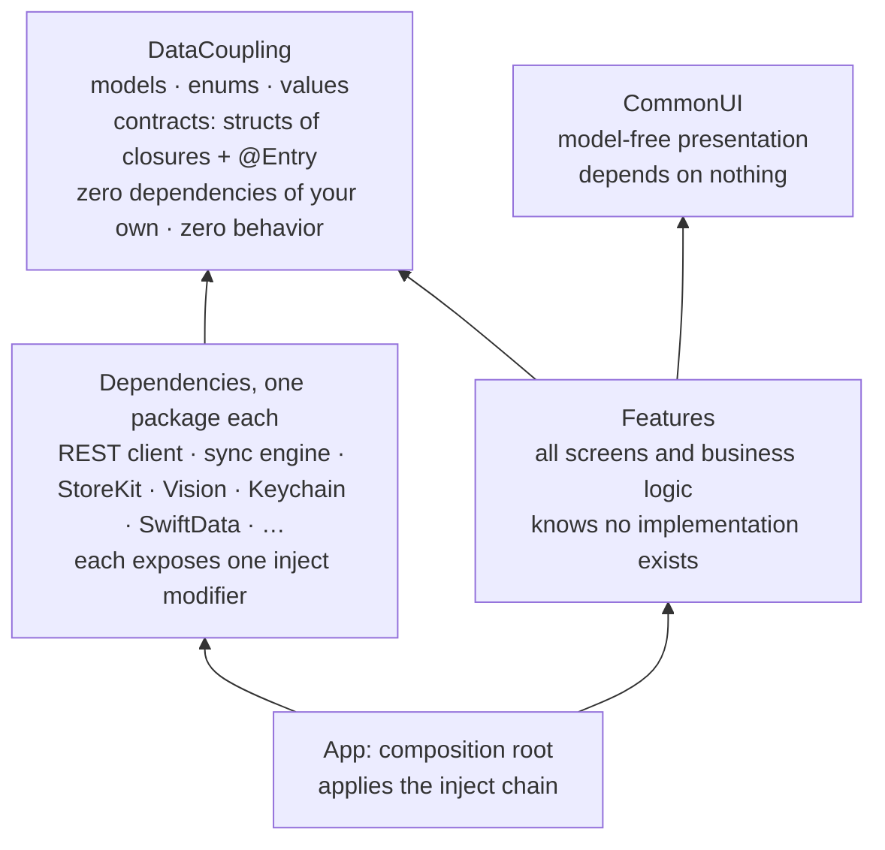

# The data coupling layer: contracts, the module graph, the root

Read this when adding a service, a dependency, an environment value, or
a package; when laying out an app's modules; or when someone reaches for
a protocol, a DI container, or a `.live` static.

Sources: the method article (the layer, flow not injection), the
masterclass (capabilities as values), Wlaschin's taxonomy, and the
module rules distilled from a shipped data-coupled app, written here in
general form.

## The layer

A module that holds state couples every importer to what it holds. A
stateless module is algorithms and cores, importable anywhere, tested
alone, owned by anyone. The state sits at the top, in the app that
composes the modules. Each module is its own package: `DataCoupling`,
`Features`, one per I/O boundary that earns a package, a backend or a
sync engine, and the app target that links them all. The layer is the
only package the others share, so a backend implements the layer's
contracts without importing a feature.

What the modules share is one more module, the data coupling layer. It
is free of behavior: the models, the closure signatures, and the
`EnvironmentValues` entries that propagate them. The composition root
constructs the implementations, features consume them, and the two meet
nowhere but in that layer's types. For the shelf that is `Book`,
`LibraryService`, and the `@Entry`.

```swift
struct Book {
    let id: String
    let title: String
    let author: String
}

struct LibraryService {
    var fetch: (_ byAuthor: Bool) async throws -> [Book] = { _ in [] }
    var save: ([Book]) async throws -> Void = { _ in }
}

extension EnvironmentValues {
    @Entry var library = LibraryService()     // the default is the minimal no-op
}
// In the layer's package both are public, the struct with a public
// initializer and the entry in a `public extension`.
```

`id` is an initializer argument, not generated inside the model and
not minted inside a node; a new id comes from the store or from a
contract closure a scenario can fix, so payloads stay deterministic.
The model may conform where the conformance adds no behavior,
`Identifiable` over that stored `id`, a synthesized `Codable`. Seeing a
protocol couples nothing. A `@Model` class carries what SwiftData
gives it, `PersistentModel` included. What the model does not get is a
method written by hand or a computed property. `ForEach(books, id: \.id)`
names the key at the call site and needs no conformance, and either
spelling is fine. Two
literals with the same `id` are one row to a `ForEach`, so a fixture
is a literal and needs no `static let` to hold identity across waves.

The method article writes the same contract with `let` members marked
`@Sendable` and the default spelled out in the `@Entry`. That form is
equivalent. The defaulted initializer makes the no-op `.init()`, which
is the form this skill uses.

Constantine ranked coupling fifty years ago. Data coupling is the
weakest, best kind there is. Every iOS "architecture" couples modules
through protocols, DI containers, or shared objects. Here modules share
one thing, a package of pure data. Data is the abstraction.

### What belongs in it

- **Models, enums, projection values.** Pure data: stored properties
  and initializers, with defaults. No computed properties, no methods.
  Lift every computed member out as a pure extension in the feature
  layer (`Book+Domain.swift`). Pure, side-effect-free logic belongs in
  the feature packages. Only I/O is isolated to the app.
- **Classes only when they earn it**, and even then as pure data.
  Default to value types. Reach for a class (usually `@Observable`) when
  it pays for itself: a lifecycle a struct cannot own (a custom source
  of truth, a system bridge, resources that need cleanup); clean
  decomposition, where `@Bindable` hands children real
  `$model.property` bindings; or per-element performance, where model
  classes in a collection are observed one by one. `deinit` is the one
  behavior allowed on data, and only to release what the object holds:
  cancel a task, stop a manager, tear down a subscription.
- **Contracts.** The service signatures, as structs of closures (next
  section), each with its `@Entry`. A contract lives in the layer even
  when its implementation lives in some other package. Folders slice by
  what the closure struct is, not by which package implements it. A
  backend's contract and its models are here too, generated from the
  server's OpenAPI document where it publishes one.
- **Data, not helpers.** Models, enums, contracts, and the values a
  feature computes and shows live in the layer whoever consumes them;
  that is the package everything reads. A helper type one feature keeps
  private, a sort option, a sheet enum, stays in that feature. When in
  doubt, ask whether it is data of the app or furniture of a screen.
- **A conformance is fine where it adds no behavior.** `Identifiable`
  over a stored `id`, a synthesized `Codable`, `Sendable`,
  `CaseIterable`. Seeing a protocol couples nothing. A conformance
  that needs a method written by hand or a computed property,
  `Comparable`, `CustomStringConvertible`, is not declared on a model.
  The comparison is a pure function in the feature that orders by it.
- **Defaulted initializers, not factories.** Give the initializer default
  parameter values instead of `make…` helpers, so the no-op default
  collapses to `.init()`. Do not add members "just in case".

## Contracts: behavior as data

A capability is a closure, or a struct of closures. Closures are
first-class values. They can be passed, stored, composed, and
substituted. Unlike classes they carry no hidden state. Unlike
protocols they need no conformance. Three shapes:

```swift
// one capability
let fetchUser: (UserID) async throws -> User

// grouped capabilities that travel together: a contract
struct UserService {
    var fetch:  (UserID) async throws -> User? = { _ in nil }
    var save:   (User)   async throws -> Void = { _ in }
    var delete: (UserID) async throws -> Void = { _ in }
}

// a local bundle, granted to one consumer, with no type to mint
let actions: (save: (Book) -> Void, delete: (Book) -> Void)
```

Pick the tuple when the bundle is used by one or two call sites in the
same module. Promote it to a named struct when it crosses a module
boundary, is reused, or needs a conformance, since tuples cannot
conform to anything. The call sites keep the same labels.

swift-core-flow's `@Capability` generates that tuple from a type or an
extension. Every eligible computed property and method is bundled into
one `Capability` typealias and a `capability` property, so a consumer
is handed the operations it may call without a protocol it must conform
to. And since Swift synthesizes only an internal memberwise init, every
public data struct in the layer needs a `public init`. `@Flowable`
writes it at the type's access level, defaults carried through, closure
fields `@escaping`.

A contract's members are closures, lets, or bindings. The root's
`@AppStorage` keys reach features this way, as a `settings` struct of
bindings built over the root's own properties, so a feature reads or
writes one value from the environment and does not name a key.

Every dependency has two parts, how it is constructed and how it is
used. How it is constructed is the app's knowledge, what the
dependency is built from and which inputs the root supplies. How it is
used is its capabilities, the contract's members, and they are all a
feature sees. The root's `@AppStorage` properties show both parts.

```swift
// The capabilities, in the layer. One binding per key.
struct BookSettings {
    var sortByAuthor: Binding<Bool> = .constant(false)
}

extension EnvironmentValues {
    @Entry var settings = BookSettings()
}

// How it is constructed, at the root. The app owns the key.
@main
struct BookApp: App {
    @AppStorage("sortByAuthor") private var sortByAuthor = false

    var body: some Scene {
        WindowGroup {
            Library()
                .environment(\.settings, BookSettings(sortByAuthor: $sortByAuthor))
        }
    }
}

// How it is used, in a feature. A binding, and no key.
@Environment(\.settings) private var settings: BookSettings
// in its body:
Toggle("By author", isOn: settings.sortByAuthor)
```

A backend has the same two parts. It may need the token to be
constructed, so the root hands its `inject` function a binding to it,
`injectBackend(baseURL: url, token: $token)`. Its capabilities are a
struct of closures, and a feature calls one and sees no token. Every
dependency follows this one principle, Robert Martin's dependency
inversion.

The consumer dictates the signature, not the implementation that will
satisfy it. The core constructs the model and hands it over (`try await
save(book)`). The closure is `async` or `throws` because the I/O can
fail. `async` is the I/O marker. Every contract closure carries its
effects in its type, and pure logic has none.

The default is the minimal no-op. An environment value's default is
`.init()` with do-nothing closures, not a `static let live`. The default is what previews and tests get. It already stubs every shape
of I/O, and a scenario overrides every closure the node's label names. What the
default of a closure that must return a value does is of no
importance. It throws where the closure throws, and where it cannot
throw it is a `fatalError`. An empty collection will do where the
result is one. The default is not a reason to change the signature,
which the node that calls it dictates, so no result is made optional
to give the default a `nil` to return. A blank value that looks real
is not used.

Mark closure types `@Sendable` only when a closure crosses an isolation
boundary. Under a main-actor default isolation most do not. Do not
add it to paper over an isolation error.

### Why this beats protocol plus class

| Concern | Protocol plus class | Struct of closures |
|---|---|---|
| Substitution | a conforming type | construct with new closures |
| Mocking in tests | subclass or mock framework | pass a logging closure |
| Composition | wrapper types, decorators | wrap a closure in a closure |
| Partial override | subclass and override one method | construct with some reused, some replaced |
| Existential cost | boxing | value semantics |
| Lines of code | N | about N/3 |

Cross-cutting concerns compose by closure wrapping. A logged or
retrying variant is a new value built from the old one, with only the
wrapped member changed. Reach for a protocol only when the compiler
must discover conformance across a module boundary (a plugin API
external callers implement), when Objective-C interop requires a class,
or when an API has ten or more methods with shared default
implementations. For the rest, a handful of closures with one live
implementation and test variants, the struct wins.

This is the dependency inversion principle, carried out. The principle
asks both sides to depend on an abstraction and neither on the other.
As it is usually practiced the abstraction is a protocol, and the
protocol sits in a whole module, beside its implementation or beside
its consumer. Importing the protocol imports that module, so one side
still sees the other and nothing was inverted. Here the abstraction is
a struct of closures in a package of its own that holds only data. A
feature imports that package, a dependency imports that package, and
neither can name anything of the other.

## The module graph



Read the arrows. Every dependency points at data. Features and the
dependency packages do not meet at compile time. A sync engine consumes
the REST contract as a value read from the environment, not the
package that implements it. What you will not find: a feature
importing a dependency, a dependency importing another or importing
the features, a protocol, a container, a mock target. Dependencies
meet only through data, wired by the environment at runtime.

- **Features** hold all screens and feature logic plus a pure shared
  layer: side-effect-free calculators, extensions on the layer's types,
  pure components. SwiftData reads in shells and system bridges
  (`UIViewControllerRepresentable`) are allowed. Ambient I/O (system
  frameworks, files, the network) is not. That goes through a contract.
- **Model-free presentation** (`CommonUI`) does not depend on the data
  layer. Design-system pieces take values, not models.
- **A dependency** is a package under `Packages/Dependencies/`, one
  for each boundary that does I/O, however small, and one for each
  dependency derived from others. It depends on the data layer, on
  platform frameworks, and on the transport or SDK library it wraps,
  which is a library and sets no contract. Its one public declaration
  is a `View` extension, `injectSyncEngine()`, over an internal
  modifier that constructs the live contract inline. Its logic is
  plain internal functions taking its inputs as parameters. A derived
  one declares `@Environment` reads of its ingredients, whose
  contracts, entries, and payload types are all in the layer. Its
  boundary's one integration test is in its own test target.
- **The app** is a pure composition shell: `@main`, the model container,
  the chain of modifiers that set the live values. The feature package
  exports one public view, the top node of its own tree, which the
  app's root constructs. Everything else in the package is internal.

Each dependency is a package because the boundary of a package is the
only thing that stops a dependency from seeing a feature. A modifier
file in the app target sees everything the app imports, and a sort
enum or a parser that lives in a feature gets used there with no
error. In a package the same line does not compile. The line for what
is a package is I/O, not size. A haptics dependency of thirty
lines is one.

The layer is the one package that lists swift-core-flow, and it
re-exports it. The features package re-exports the layer. A feature
file then sees the layer and the macros with no import of either, and
the library's version is set in one manifest.

Where each of these sits on disk, its manifest, and the project file
are in `app-structure.md`.

## The composition root

Every app has one, `@main`, where the live values are set once. Keep it
flat and inline.

- **The root builds the live value inline, where it sets it.** The
  modifier that sets a value is the one place that already holds the
  implementation's
  inputs: a base URL, a transport closure, `\.modelContext`, a contract
  set upstream. Implementation logic the closures call is plain
  `internal` functions taking those as parameters.
- **One modifier per dependency, one system framework per dependency.**
  StoreKit, Vision, LocalAuthentication, Security, and UserNotifications
  each appear in one package in the codebase. A dependency may bundle
  related contracts and carry its implementation details privately.
- **The chain is applied inline at the root**, with no umbrella wrapper.
  It is used once, and it reads top to bottom. Ordering matters only
  where one modifier reads a value another set. The reader sits
  inside.
- **These modifiers are not views.** They are the points where the root
  sets values into the environment, and they stay in the app forever.
- **Previews do not touch real storage.** A preview does not set the real
  storage-backed service or write `UserDefaults`. That is root plumbing,
  and it breaks previews with no error. Lean on the default. A specific
  value comes from `@Previewable @State` bound into a defaulted
  initializer.

### No `.live`, `.preview`, `.unimplemented`, and no `+Live` files

Do not attach an implementation to a contract type by extension
(`extension LibraryService { static func live(baseURL:) }` in a
`LibraryService+Live.swift`). It makes the implementation look like
part of the contract, scatters the type across packages, and forces a
jump from the modifier that sets the value to another file to read the
wiring. The no-op
default already serves previews and tests, and a scenario builds the
logger. Corollary: a pure value that can be created with no inputs, a
formatter, a calendar, does not belong in the environment; I/O with no
inputs, a file written to the temporary directory, still does, since
the boundary is the I/O, not the inputs.

## Flow, not injection

Dependency injection is an OOP patch. Objects fuse state and behavior,
so before anything can run an object graph must be assembled with
constructors, containers, and resolvers. That graph is invisible,
global, and frozen at assembly time, and every screen depends on it.

Here there is no object graph, so there is nothing to inject into. A
capability is a value, and it travels the same reactive dataflow graph
as every other value: down the view tree, through `@Environment`, like
state. Nothing has a constructor waiting to be filled. The root's modifiers
set a value into the flow.

`@Entry` drops a value straight down. For events that must travel up,
such as a deeplink any node may emit and the mounted nodes handle,
`@FlowUp var deeplink: (URL) -> Void` in an `EnvironmentValues`
extension in the layer, where the `@Entry` values are, declares a typed
flow. `.collectFlow(\.deeplink)` goes on the accumulator at the top of
the subtree, `.onFlow(\.deeplink) { … }` on each listener, and
`@Environment(\.deeplink)` hands any node below a real closure that
calls every registered listener. It is scoped to the subtree under its
accumulator. Unmounting unregisters, and nothing leaks. One accumulator
at the app root that every event of the app goes through is the global
bus this avoids. Name a flow for what the caller means. A verb is a
command whose listeners are the implementation (`deeplink`). A
past-tense clause is a notification that something already happened, a
service's verb (`logoutHappened`) or a change the system made
(`scenePhaseChanged`). Do not name it after the reaction.

What reaches the app from outside it reaches the features the same
way, and the rule is general. When the event or the data behind a
modifier comes from outside the app, the node that carries the modifier
is a shell, and its handling waits on the system. Recognize the case by
the source and by nothing else. `.onOpenURL`, `.onContinueUserActivity`,
and a change of the scene phase are three such sources, and any other
is treated the same, whether or not a test could fake it some other
way. A flow makes the testable core. The system's own modifier is kept
to one line in one place, inside a `ViewModifier` at the root, and it
only forwards. That modifier is applied before the accumulators in the
chain, so it sits inside them and can call the flows:

```swift
extension EnvironmentValues {
    @FlowUp var deeplink: (URL) -> Void
    @FlowUp var scenePhaseChanged: (ScenePhase) -> Void
}

// the root's, and the only place the system is heard
struct SystemEvents: ViewModifier {
    @Environment(\.scenePhase) private var scenePhase
    @Environment(\.scenePhaseChanged) private var scenePhaseChanged
    @Environment(\.deeplink) private var deeplink

    func body(content: Content) -> some View {
        content
            .onOpenURL { deeplink($0) }
            .onChange(of: scenePhase) { _, phase in
                scenePhaseChanged(phase)
            }
    }
}

Landing()
    .modifier(SystemEvents())
    .collectFlow(\.deeplink)
    .collectFlow(\.scenePhaseChanged)
```

That modifier hears the outside world, so it is a dependency like any
other. It is its own package under `Packages/Dependencies/`, the root
applies it through the package's one `inject` modifier, and the flows
it forwards into are declared in the layer beside the `@Entry` values.
In a package the declaration is `@FlowUp public var`, in an extension
that is not itself marked `public`.

Where the system delivers through a delegate and not through a
modifier, a tap on a notification, the form is the same. The
dependency that owns the delegate reads the flow in its `inject`
modifier and hands the delegate the flow's closure, and the delegate
only forwards. The root applies that `inject` modifier inside the
collector.

What the app does about the event is a core, a node below that listens
with `.onFlow(\.deeplink) { url in … }` and writes or calls in the
closure. The listener sits in the node that owns the state the
handling writes. Its scenario stands in for the system. It applies the
accumulator itself, as the root does, and a control below it calls the
flow:

```swift
struct LibraryScenario: View {
    var body: some View {
        VStack {
            Library.Core(books: [dune])     // it listens to the flow
            SystemControls()                // below the accumulator
        }
        .collectFlow(\.deeplink)
    }
}

private struct SystemControls: View {       // stands in for the system
    @Environment(\.deeplink) private var deeplink

    var body: some View {
        Button("link") { deeplink(URL(string: "books://book/42")!) }
    }
}
```

The UI test taps `link`, and the log is what `Library` wrote and
called. So the handling is tested and the forwarding line is not. A
listener hears the event for as long as its node is in the graph. That
includes a node covered by a pushed screen and one in an unselected
tab. Unmounting unregisters it. A link that launches the app reaches a
listener in the first screen too, measured from a cold launch. The
scene phase as a fact, a cover shown
while the app is inactive, is data a node reads. Only the answer to the
change goes through the flow. The accumulators at the root are for
these few events that are the system's and app-wide, not for
everything.

| OOP dependency injection | dependency flow |
|---|---|
| assemble the graph before runtime | values flow at runtime, continuously |
| one global wiring | replaced below the root in a preview or a scenario |
| swap = reconfigure the container | swap = flow a different value |
| mock = protocol plus mock class | mock = `.init()` |
| a change re-resolves the graph | a change recomputes dependent views, like any state |

> State flows down. Events flow up. Capabilities flow down too.
> A dependency is just state.

Wlaschin's six approaches, and which this architecture uses:

| Approach | Verdict | Here |
|---|---|---|
| dependency retention | scripts only | none |
| dependency rejection | best: pure core, I/O at the edges | calculators and pure extensions, data in and data out, not even a closure |
| dependency parameterization | when the core needs a capability | the structs of closures, except the parameters are not hand-threaded. They flow |
| dependency injection (OO) | when forced | rejected. No constructor anywhere waits to be filled |
| reader monad, interpretation | too clever | none |

Reject what can be rejected. Parameterize the rest. Let the parameters
flow. Flow is the SwiftUI-native upgrade over hand-threading that F#
could not express.

Visibility was not the coupling. Apple exposes everything to every
feature through the environment. Seeing a capability couples nothing.
Consuming it does. Hiding dependencies mattered in OO because a
dependency was a stateful reference, and seeing one meant being able to
corrupt it. A closure can only be called. A contract is not split for
size. A struct of three hundred closures holds no state and no
invariant, and a node that calls one is coupled to one signature. A
smaller record sliced off for a feature is taste, not rescue.

## Do not

- **Property-wrapped dependencies inside a class.** `@Environment`,
  `@AppStorage`, `@Query`, and `@FocusState` resolve only inside a
  `DynamicProperty` context. In a class they drive no wave and raise no
  error. `@AppStorage` there still writes to the defaults, and it does
  not follow them.
- **A service locator or singleton** (`Services.shared`). Untestable, no
  override points, shared mutable state. A value in the environment can
  be overridden at any level of the tree and needs no framework.
- **A protocol per dependency by default**, with `LiveX` and `MockX`
  classes behind it. The struct of closures gives the same
  substitutability, and the test variant is one more value.
- **An `@Observable` service class.** State stays in views. Behavior
  stays in closures.
- **A dependency that can be made with no inputs.** It is a constant.
  Use it directly.

## Checklist

- [ ] Every shared type is pure data. Computed members are extensions in
      the feature layer.
- [ ] Every contract is a struct of closures, lets, or bindings with a
      defaulted initializer and an `@Entry` whose default is `.init()`.
- [ ] Every `async` and `throws` lives in a contract closure. Pure logic
      has none.
- [ ] Features and dependencies depend on the data layer and not on
      each other. Presentation depends on nothing.
- [ ] Every dependency that does I/O is its own package under
      `Packages/Dependencies/`, imports no feature and no other
      dependency, and exposes exactly one public `inject` modifier.
- [ ] Live values are built inline in those modifiers, one system
      framework per dependency, and the root applies the chain.
- [ ] No `.live`, `.preview`, or `.unimplemented` statics, no `+Live`
      files, no singleton, no container, no protocol for mocking.
- [ ] Previews rely on the defaults and touch no real storage.
