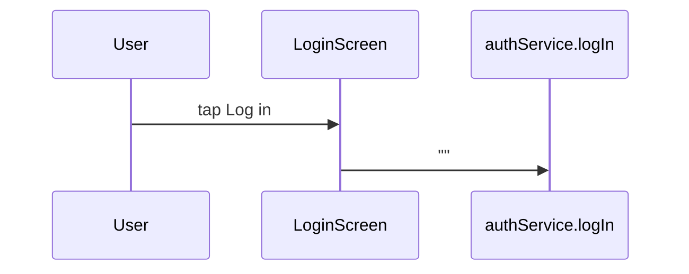

## Evidence

The call is the whole evidence — a zero-argument command logs an empty
payload. What logging in *does* is not this node's business: the root
owns the login state, and `authService.logIn` is a closure over it,
assembled at injection. The gate flipping is the root's wiring, never
this node's evidence.
