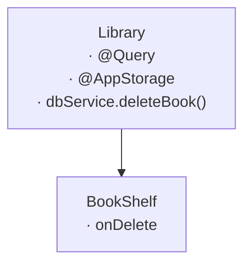
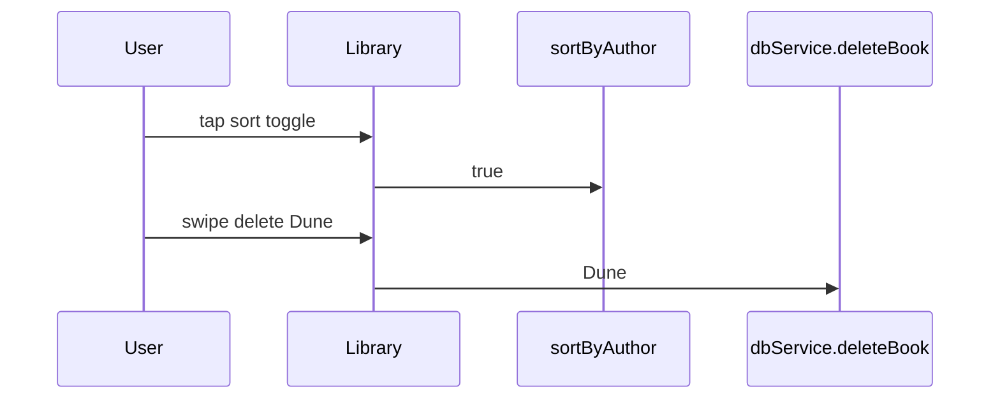

## Evidence

Library is the shelf's parent: the toggle and the swipe happen inside
its collapsed subtree, and at Library's edge they are a storage write
and a capability call. The shelf's own block shows the same two
interactions as a binding write and a callback — the same events, one
level down.
