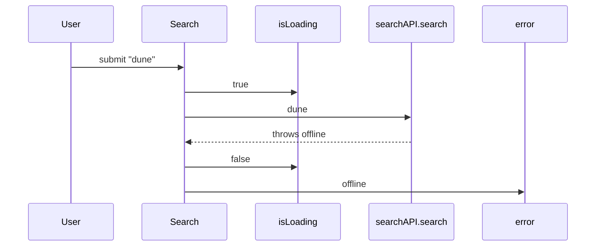

## Evidence

Macro-free test form (F20): the `isLoading` and `error` out-arrows are
own state, unloggable without tooling — the test asserts the boundary
log `["search dune"]` plus the rendered consequence (`statusLabel`
reads `offline`). The block above stays the full declaration; the log
array a macro-free test asserts is the ordered *boundary* out-arrows.
