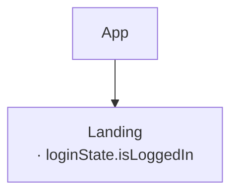
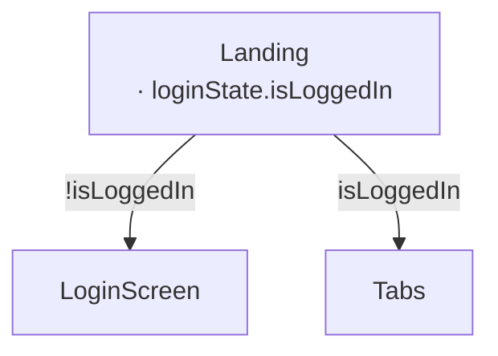
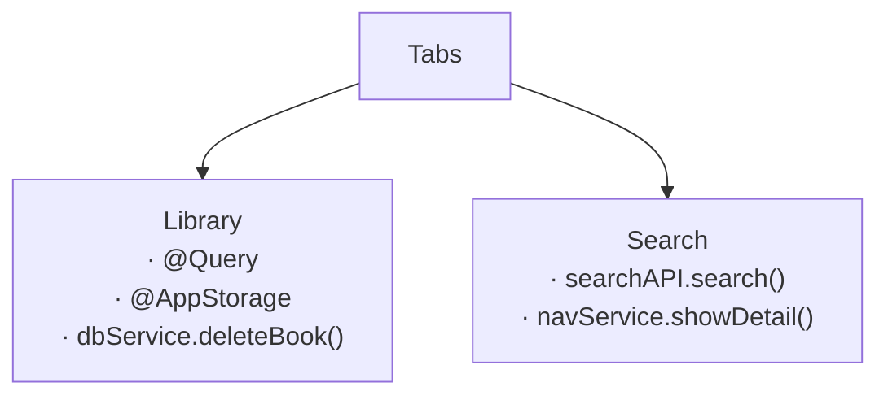
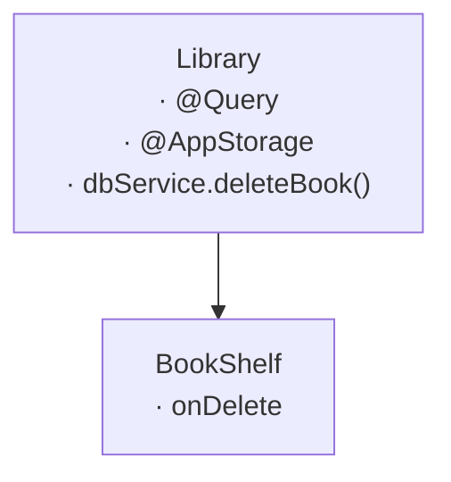
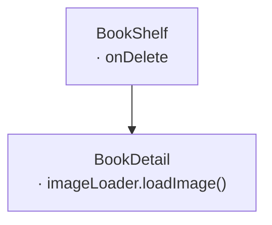
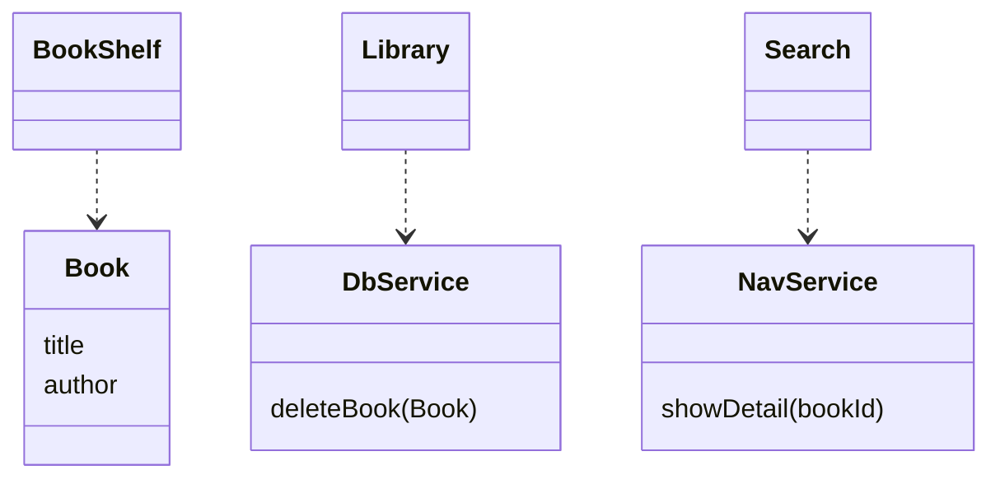
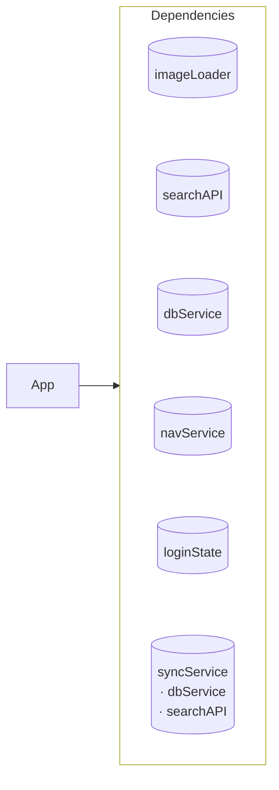
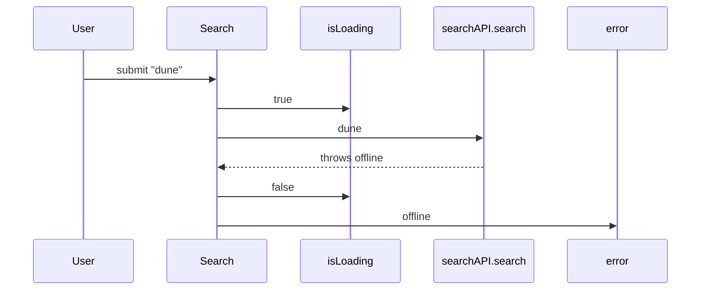

# hypermodular — Top-Down Development behavioral mapping

TDD means **Top-Down Development**: the app is modeled as a tree of
behavior before it is built; development flows from the root toward the
leaves; each node's evidence is declared before its code. The map is
Mermaid in markdown (`APP-MAP.md` at the repo root, `MAP.md` beside each
mapped subtree), so it renders in every GitHub/GitLab PR — always
visible, always diffable.

The map is behavioral, not an inventory: it shows where decisions live
and what they ask of the world, nothing else. Renaming a button never
touches it; moving a decision always does. **Structure lives where
authority lives** — the map is that structure, written down.

The architecture this produces is **hypermodular**: one mermaid is one
module is one boundary. No map knows more than one level, and the whole
app is reconstructable by merging nodes on their names — so the global
view is always derivable and never maintained.

This file is the doctrine. The two jobs it serves each have a playbook,
and the details each needs have a reference:

- `references/architecting.md` — a new app or feature: who decides,
  the order of work, what to present.
- `references/reverse-engineering.md` — a codebase that exists and has
  no map: the walk, what legacy code throws at the notation, findings.
- `references/notation.md` — the complete grammar: every label-line
  kind, identity rules, the dependency column, evidence blocks,
  reserved words, the checker.
- `references/evidence.md` — declaring behavior as a log: entry kinds,
  whose source of truth, discipline, why the log is the contract.
- `references/coreflow-example-validation.md` — a worked run of both
  jobs against a real app, with every finding and ruling.

## The three rules

1. **Build top-down.** Implement a node only after its parent exists.
   New features are drawn on the map before any code is written. The
   vertical axis is **authority, not existence**: the parent dictates
   the child's signature and the child satisfies it; a service's
   signature is dictated by its callers, never by its implementation.
   A change of mind at the top has one place to land, and everything
   below that no longer fits stops compiling instead of drifting. A
   feature has an address — it is a node, and the map is where to
   find it.
2. **Respect the map.** When working on a node, touch only that node's
   own code and the capabilities named in its own label. Needing one
   that isn't on the map means stopping and proposing a map change
   first — that diff is the design review.
3. **Evidence, not effects.** A node's behavior is declared as data:
   these values in, this evidence out — the ordered log of its I/O
   with payloads: every source-of-truth write and every boundary call,
   sync or `async throws` alike.
   A node's inputs are values, bindings, and closures — nothing else —
   so it is constructible from literals, and anything constructible
   from literals is testable by construction. Declare the evidence
   before implementing; implementation means making the declaration
   hold. Never observe effects behind a boundary, never simulate
   behavior (no mocks): a boundary in a spec is a logger, and checking
   a node is comparing two values. Refactor the node and the log cannot
   change; only a changed requirement can — which is why the log, not
   the structure, is the contract.

## One law: depth 1 — the cure for death by a thousand mocks

Mock depth is the number of layers of internal behavior a test double
must simulate before the unit under test can even be constructed. In an
object graph it is unbounded — lift one card and you hold the tower —
and that is what test-driven development died of. Here it is one,
permanently: every artifact describes exactly one boundary — its own. A
logged boundary never simulates deeper than one step, because a
closure's signature is the whole contract and nothing is behind it.
Injection enters only at the root. And a map draws only one level: a
node and its immediate children. This is what keeps all three honest.

## Diagram 1: the structure tree

A `flowchart TD`, one level deep. Solid arrows are data flow — parent
hands the child its data, bindings, and callbacks; the child never
reaches up or sideways, and cross-feature arrows are forbidden.

- **Mermaid id = node name, always** — the name is the join key that
  merges maps back into one tree.
- **Label = name, then one `· ` contract line per line.** Four kinds,
  distinguishable by parser: `· @Source` **materializes** a source of
  truth that outlives the node (`· @Query`, `· @AppStorage`);
  `· dep.func()` **calls** a capability and logs; `· dep.value`
  **reads** one and never logs; a bare `· name` is a **callback** the
  parent handed down. The lines are the node's entire outbound
  relationship with the world; a name-only label receives everything
  and calls nothing.
- **A node is a collapsed subtree.** Rows, buttons, design-system
  pieces are furniture; a subtree is a node only when it joins the app
  lifecycle independently — own outliving state, appearance work, a
  navigation destination, its own boundary call.
- **A decision labels its alternative arrows with the deciding value**
  (`-->|isLoggedIn|`); unlabeled arrows are composition. Possibility,
  never sequence.
- **Unbuilt nodes are bare leaves** — mapped, reachable, empty.
  Finished design.

One module = one mermaid, chopped at every level. A node carries its
full contract everywhere it appears — as a child in its parent's map and
as the root of its own: double-entry bookkeeping. Every block opens with
a `%%` comment declaring its place. The root map:



Landing's map (the login gate — a decision node):



Tabs' map (unlabeled arrows — plain composition):



Library's map — the fetch and the store live here, lifted out of the
shelf that shows them:



BookShelf's map, beside its code. It takes `books` as a value (a sorted
fetch, eventually), `sortByAuthor` as a binding (storage, eventually),
and `onDelete` as a closure (a service, eventually) — constructible from
literals, complete before any of the three exists:



Leaves get no structure map — a map earns its existence by having
arrows. A leaf's contract lives in its parent's map; a leaf whose
evidence crosses its edge gets a `MAP.md` of evidence blocks only.
Merging these on their shared node names reconstructs the whole tree —
the hypermodular property, demonstrated. Full grammar, identity rules,
and the multi-root / `Unmounted` forms: `references/notation.md`.

## Diagram 2: the data coupling layer

A `classDiagram` of the shared vocabulary: models and service
signatures. Field names without elaboration; services as bare closure
signatures; `..>` records consumption. Coupling is consumption, not
visibility — everything is visible to everyone, and only use creates a
line. A signature here is dictated by the nodes that consume it, never
by the implementation that will eventually satisfy it.



Read it diagnostically: modules sharing many types are secretly one
module; a type referenced everywhere is core domain, expensive to change.

## Diagram 3: dependencies

The world's surface and one fact about it: the root injects all of it.
No usage lines — usage is written on the nodes themselves.

- **A dependency is an environment value: a plain struct composed of
  closures, lets, or bindings.** No protocols, no classes, no
  reference-type service objects. The live implementation, the preview
  stub, and the logging spec host are different member sets of the
  same struct.
- Name the boundary, not the tech: `dbService`, not `swiftData`. Native
  materialization (`@Query`, `@AppStorage`) is not a dependency — it's
  facts arriving, tagged on the node label. How a capability's closure
  is assembled behind its cylinder is implementation detail and never
  drawn.
- **Injection is normal data flow**: one arrow from the root into the
  box. A second arrow into the box means injection leaked.
- **Top to bottom is injection order**; a derived service lists its
  ingredients, which must sit above it.



The box's size is a health metric on its own. A cylinder on the map is
a signature, not an implementation: fetch, storage, service — all
*eventually*. A node is done when its evidence holds against loggers;
the live closure behind each cylinder arrives later and is tested once,
for real.

## Declaring evidence

A node's declared behavior is one value: the evidence log — the ordered
`(name, payload)` record of its I/O. Two kinds of entry, nothing else: a
**source-of-truth mutation** logs under the property's name (a binding
write, an external-storage write, the node's own state write); a
**boundary call** logs under the closure's name with its arguments,
whatever the closure's shape — sync, `async throws`, returning. The
call is the event; what comes back is supplied data. **Reads never
log.** The test for a write is whose source of truth it lands in, never
who holds the pen: a text field writing the node's `title` logs every
keystroke though the system held the pen; the system moving focus logs
nothing, because focus is the system's.

A declaration is an acceptance criterion transcribed: *given* names
constructor arguments, *when* an interaction, *then* the log. "Given no
connection, when the user searches, then it reports offline and writes
no books":

```
["isLoading true", "search dune", "isLoading false", "error offline"]
```

The simplest case is the shelf: `["sortByAuthor true", "delete Dune"]`
— a binding write and a callback, nothing behind either. Assert order
only when the requirement names it; silence is evidence; pin the
material as-is. One integration test per cylinder, at the shell, owns
each boundary's real implementation — a node's evidence proves only the
decision to cross it. The rest: `references/evidence.md`.

## Diagram 4: evidence

One `sequenceDiagram` per acceptance criterion whose log crosses the
node's edge. Arrows into the node are the *when*; arrows out are the
*then* — one log entry each, in order, so the test's array is exactly
the out-arrows; dashed arrows back are supplied data, never entries.
Own-state-only criteria stay arrays in the test: the map shows edges.



Blocks live in the node's own `MAP.md` under `## Evidence`, once. The
block is the source and the test is written from it — double-entry,
like a label and its copy. Targets, stimuli, `loop`, silence, reserved
words: `references/notation.md`.

## Workflows

**Architecting a new app or feature** — `references/architecting.md`.
The owner decides the tree; draw it with the user and agree it; declare
evidence for every edge-crossing node; run `scripts/mapcheck.py`; build
root-down, each node's evidence holding before the next; cylinders
last, each tested once for real. In a mapped repo a feature enters the
map first, and the map diff is the design review.

**Reverse-engineering a legacy codebase** — `references/reverse-engineering.md`.
Walk instantiation from the entry point, attribute every I/O call to
the node that decides it, apply the cuts while walking, verify
injection at the root only, write depth-1 maps. Never invent evidence:
draw a block only where a pinned log already exists. Present the two or
three most interesting findings — the first map is a free architecture
review.

**Maintaining.** The map is code: any change that moves a decision,
changes a contract, adds a capability, or changes what a node does at
its edge updates the affected maps — structure or evidence — in the
same commit, and the checker runs. In a mapped repo, read `APP-MAP.md`
before reading code, and treat rule 2 as the work fence. If map and
reality disagree, say so and fix one of them — never silently work
around.

## Style

Ids are names — the merge key — and labels carry the contract. No
colors, no emoji, no fills, no status markers — whether a node's
declared evidence holds is the only "done" that exists, and it lives in
the repo, not the map.

## References

- [SwiftUI Data Flow Masterclass](https://medium.com/@redhotbits/swiftui-data-flow-masterclass-099f0768f776)
  — the data-flow model this method rests on: nodes, waves, boundary
  events, execution-log testing.
- [TDD: Death by a Thousand Mocks](https://medium.com/@redhotbits/tdd-death-by-a-thousand-mocks-26adb60cbe43)
  — the argument: the layer diagram is a construction schedule; flip
  the axis to authority; mock depth is what TDD died of.
- [TDD Is Dead. Long Live TDD.](https://medium.com/@redhotbits/tdd-is-dead-long-live-tdd-f85b4b9eacbd)
  — the method: lift state and services, lock the core with evidence,
  delegate the detail.
- [swift-core-flow](https://github.com/sisoje/swift-core-flow) — the
  mechanics: macros for the shell/core split and evidence logging.
- [swiftui-mv-architecture](https://github.com/redhotbits/swiftui-mv-architecture)
  — the style: what a node's implementation looks like.
