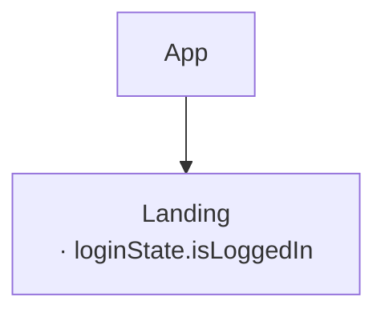
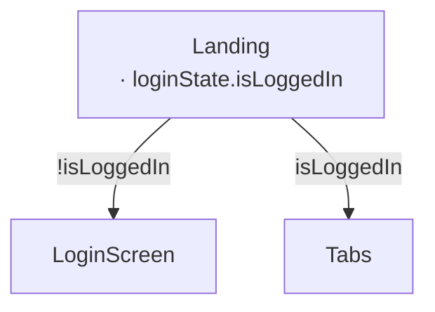
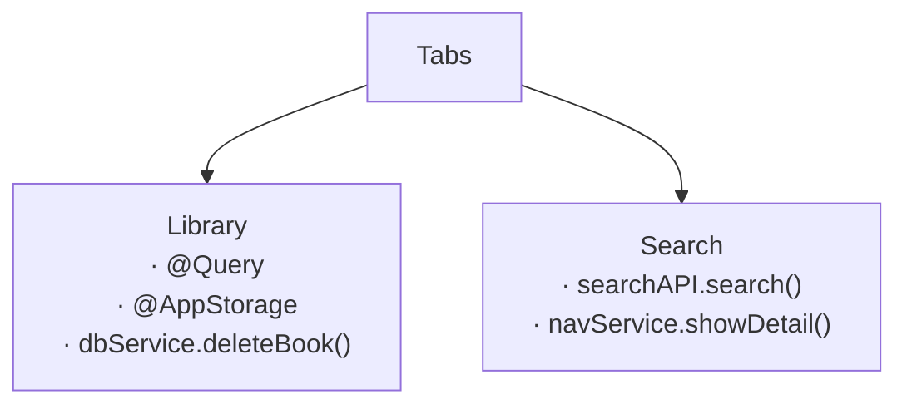
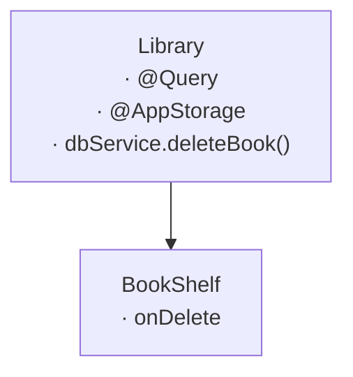
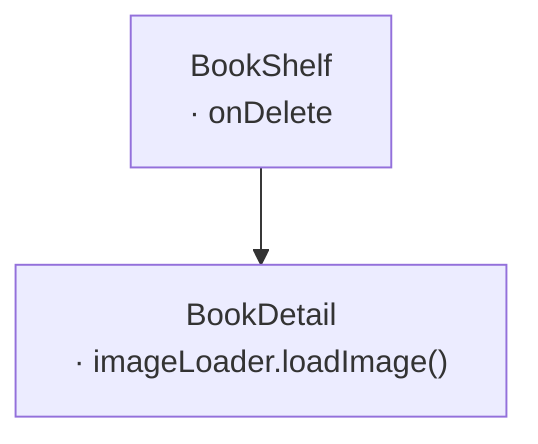
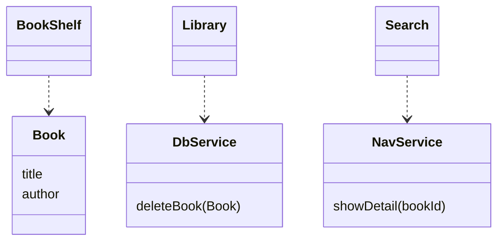
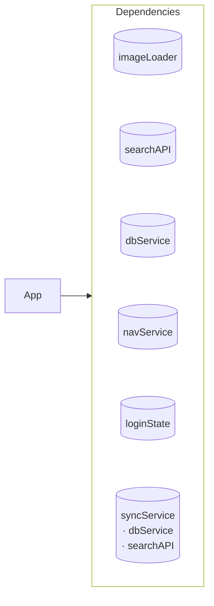
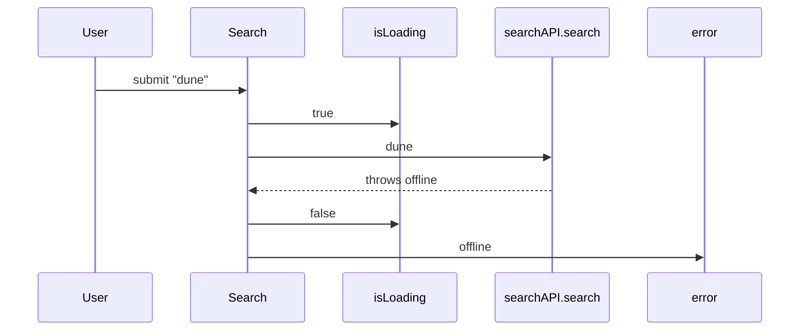

# hypermodular: Top-Down Development behavioral mapping

TDD means Top-Down Development. The app is modeled as a tree of
behavior before it is built. Development flows from the root toward the
leaves. Each node's evidence is declared before its code. The map is
Mermaid in markdown (`APP-MAP.md` at the repo root, `MAP.md` beside each
mapped subtree), so it renders in every GitHub or GitLab PR, always
visible and always diffable.

The map is behavioral, not an inventory. It shows where decisions live
and what they ask of the world, nothing else. A node's whole observable
behavior is the children it creates and its boundary events, and
nothing else about it is observable. Diagram 1 draws the children, the
ones that are nodes, with furniture collapsed. Diagram 4 declares the
boundary events. Renaming a button never touches the map. Moving a
decision always does. Structure lives where authority lives, and the
map is that structure, written down.

The architecture this produces is hypermodular. One mermaid is one
module is one boundary. No map knows more than one level, and the whole
app is reconstructable by merging nodes on their names, so the global
view is always derivable and never maintained.

This file is the doctrine. The two jobs it serves each have a playbook,
and the details each needs have a reference:

- `references/architecting.md`, a new app or feature: who decides, the
  order of work, what to present.
- `references/reverse-engineering.md`, a codebase that exists and has
  no map: the walk, what legacy code throws at the notation, findings.
- `references/notation.md`, the complete grammar: every label-line
  kind, identity rules, the dependency column, evidence blocks,
  reserved words, the checker.
- `references/evidence.md`, declaring behavior as a log: entry kinds,
  whose source of truth, discipline, why the log is the contract.
- `references/coreflow-example-validation.md`, a worked run of both
  jobs against a real app, with every finding and ruling.

The code side of a node (the data-flow model, lifting, the shell/core
cut, the execution log, the module graph) is the `data-coupling` skill
beside this one, `../data-coupling/SKILL.md`. This skill draws. That one
writes. When the question is how a node's Swift should look, go there.

## The three rules

1. **Build top-down.** Implement a node only after its parent exists.
   New features are drawn on the map before any code is written. The
   vertical axis is authority, not existence. The parent dictates the
   child's signature and the child satisfies it. A service's signature
   is dictated by its callers, never by its implementation. A change of
   mind at the top has one place to land, and everything below that no
   longer fits stops compiling instead of drifting. A feature has an
   address. It is a node, and the map is where to find it.
2. **Respect the map.** When working on a node, touch only that node's
   own code and the capabilities named in its own label. Needing one
   that is not on the map means stopping and proposing a map change
   first. That diff is the design review.
3. **Evidence, not effects.** A node's behavior is declared as data:
   these values in, this execution log out. The log is every
   source-of-truth write and every boundary call with its payload, in
   order, sync or `async throws` alike. A node's inputs are values,
   bindings, and closures, nothing else, so it is constructible from
   literals, and anything constructible from literals is testable by
   construction. Declare the evidence before implementing.
   Implementation means making the declaration hold. Never observe
   effects behind a boundary, and never simulate behavior. A boundary
   in a spec is a logger, and checking a node is comparing two values.
   Refactor the node and the log cannot change. Only a changed
   requirement can. That is why the log, not the structure, is the
   contract.

## One law: depth 1, the cure for death by a thousand mocks

Mock depth is the number of layers of internal behavior a test double
must simulate before the unit under test can be constructed. In an
object graph it is unbounded, and that is what test-driven development
died of. Here it is one, permanently. Every artifact describes one
boundary, its own. A logged boundary never simulates deeper than one
step, because a closure's signature is the whole contract and nothing
is behind it. Dependencies enter the flow only at the root. A map draws
only one level, a node and its immediate children. This is what keeps
all three honest.

The method's reach is set by material, not by framework. It holds
wherever the unit is a value constructible from literals. SwiftUI made
the view one, which is why the skill is written in SwiftUI. It fails on
any node built from objects, however reactive the pipeline around them.

## Diagram 1: the structure tree

A `flowchart TD`, one level deep. Solid arrows are data flow. The
parent hands the child its data, bindings, and callbacks. The child
never reaches up or sideways, and cross-feature arrows are forbidden.

- **Mermaid id = node name, always.** The name is the join key that
  merges maps back into one tree.
- **Label = name, then one `· ` contract line per line.** Four kinds,
  distinguishable by parser. `· @Source` materializes a source of truth
  that outlives the node (`· @Query`, `· @AppStorage`). `· dep.func()`
  calls a capability and logs. `· dep.value` reads one and never logs.
  A bare `· name` is a callback the parent handed down. The lines are
  the node's entire outbound relationship with the world. A name-only
  label receives everything and calls nothing.
- **A node is a collapsed subtree.** Rows, buttons, and design-system
  pieces are furniture. A subtree is a node only when it joins the app
  lifecycle on its own: own outliving state, appearance work, a
  navigation destination, its own boundary call.
- **A decision labels its alternative arrows with the deciding value**
  (`-->|isLoggedIn|`). Unlabeled arrows are composition. Possibility,
  never sequence.
- **Unbuilt nodes are bare leaves.** Mapped, reachable, empty. Finished
  design.

One module is one mermaid, chopped at every level. A node carries its
full contract everywhere it appears, as a child in its parent's map and
as the root of its own. That is double-entry bookkeeping. Every block
opens with a `%%` comment declaring its place. The root map:



Landing's map, the login gate, a decision node:



Tabs' map, with unlabeled arrows, plain composition:



Library's map. The fetch and the store live here, lifted out of the
shelf that shows them:



BookShelf's map, beside its code. It takes `books` as a value (a sorted
fetch, eventually), `sortByAuthor` as a binding (storage, eventually),
and `onDelete` as a closure (a service, eventually). It is constructible
from literals and complete before any of the three exists:



Leaves get no structure map. A map earns its existence by having
arrows. A leaf's contract lives in its parent's map. A leaf whose
evidence crosses its edge gets a `MAP.md` of evidence blocks only.
Merging these on their shared node names reconstructs the whole tree,
which is the hypermodular property, demonstrated. The full grammar, the
identity rules, and the multi-root and `Unmounted` forms are in
`references/notation.md`.

## Diagram 2: the data coupling layer

A `classDiagram` of the shared vocabulary: models and service
signatures. Field names without elaboration. Services as bare closure
signatures. `..>` records consumption. Coupling is consumption, not
visibility. Everything is visible to everyone, and only use creates a
line. A signature here is dictated by the nodes that consume it, never
by the implementation that will eventually satisfy it. This layer is
what the method is for. Every node couples to the rest of the app
through this data alone, the models, the closure signatures, and the
environment entries that carry them, and through nothing else. The
three rules exist to keep it that way.



Read it diagnostically. Modules sharing many types are one module in
disguise. A type referenced everywhere is core domain, expensive to
change.

## Diagram 3: dependencies

The world's surface, and one fact about it. The root sets all of it. No
usage lines. Usage is written on the nodes themselves.

- **A dependency is an environment value: a plain struct composed of
  closures, lets, or bindings**, with a no-op default. No protocols, no
  classes, no reference-type service objects. No `.live`, `.preview`,
  or `.unimplemented` statics and no `+Live` files. The root builds the
  live value inline where it sets it. How a contract is written,
  defaulted, and set at the root is in
  `../data-coupling/references/modules.md`.
- Name the boundary, not the tech: `dbService`, not `swiftData`. Native
  materialization (`@Query`, `@AppStorage`) gets no cylinder. The root
  does not set it. It is facts arriving, tagged on the node label. How
  a capability's closure is assembled behind its cylinder is
  implementation detail and never drawn.
- **Setting a value is normal data flow.** One arrow from the root into
  the box. A second arrow into the box means a value was set below the
  root.
- **Top to bottom is the order the root sets them.** A derived service
  lists its ingredients, which must sit above it.



The box's size is a health metric on its own. A cylinder on the map is
a signature, not an implementation. Fetch, storage, service, all eventually. A node is done when its evidence holds against loggers. The
live closure behind each cylinder arrives later and is tested once, for
real.

## Declaring evidence

A node's declared behavior is one value, the execution log: the ordered
`(name, payload)` record of its boundary events, every write and every
call with its payload. Two kinds of entry, nothing else. A
source-of-truth mutation logs under the property's name (a binding
write, an external-storage write, the node's own state write). A
boundary call logs under the closure's name with its arguments,
whatever the closure's shape: sync, `async throws`, returning. The call
is the event. What comes back is supplied data. Reads never log. The
test for a write is whose source of truth it lands in, never who holds
the pen. A text field writing the node's `title` logs every keystroke
though the system held the pen. The system moving focus logs nothing,
because focus is the system's.

A declaration is an acceptance criterion transcribed. *Given* names
constructor arguments and stubs, *when* an interaction, *then* the log. "Given no
connection, when the user searches, then it reports offline and writes
no books":

```
["isLoading true", "search dune", "isLoading false", "error offline"]
```

The simplest case is the shelf, `["sortByAuthor true", "delete Dune"]`,
a binding write and a callback, nothing behind either. The test
compares the whole log with one equality, so a call the declaration
did not name fails it. Assert order only when the requirement names
it. Silence is evidence. Record the
behavior as-is. One integration test per cylinder, at the shell, owns
each boundary's real implementation. A node's evidence proves only the
decision to cross it. The rest is in `references/evidence.md`.

## Diagram 4: evidence

One `sequenceDiagram` per acceptance criterion whose log crosses the
node's edge, that is, a call, a callback, or a write into a source the
node was handed or materializes. Arrows into the node are the *when*.
Arrows out are the *then*, one log entry each, in order, so the test's
array is exactly the out-arrows. Dashed arrows back are supplied data,
never entries. A stimulus is `User`, `System`, or a child firing a
callback the parent handed it (`AddItem->>ShoppingList: onAdd eggs`),
which is the only way an event reaches a parent from inside its own
tree. Own-state-only criteria stay arrays in the test. The map shows
edges.



Blocks live in the node's own `MAP.md` under `## Evidence`, once. The
block is the source and the test is written from it, double-entry like
a label and its copy. Targets, stimuli, `loop`, silence, and reserved
words are in `references/notation.md`.

## Workflows

**Architecting a new app or feature.** `references/architecting.md`.
The owner decides the tree. Draw it with the user and agree it. Declare
evidence for every edge-crossing node. Run `scripts/mapcheck.py`. Build
root-down, each node's evidence holding before the next. Cylinders
last, each tested once for real. In a mapped repo a feature enters the
map first, and the map diff is the design review.

**Reverse-engineering a legacy codebase.**
`references/reverse-engineering.md`. Walk instantiation from the entry
point, attribute every I/O call to the node that decides it, apply the
cuts while walking, verify values are set at the root only, write
depth-1 maps. Never invent evidence. Draw a block only where a pinned
log already exists. Present the two or three most interesting findings.
The first map is a free architecture review.

**Maintaining.** The map is code. Any change that moves a decision,
changes a contract, adds a capability, or changes what a node does at
its edge updates the affected maps, structure or evidence, in the same
commit, and the checker runs. In a mapped repo, read `APP-MAP.md`
before reading code, and treat rule 2 as the work fence. If map and
reality disagree, say so and fix one of them. Never work around it
without saying.

## Style

Ids are names, the merge key, and labels carry the contract. No colors,
no emoji, no fills, no status markers. Whether a node's declared
evidence holds is the only "done" that exists, and it lives in the
repo, not the map.

## Vocabulary

The articles' terms, and what the map calls them.

| Map | Articles |
|---|---|
| execution log | the same: the ordered record of boundary events, every write and call with its payload. The skill splits the entries into source-of-truth writes and boundary calls. |
| evidence block (Diagram 4) | an acceptance criterion drawn. "The test wants the evidence, not the effect": *given* in the header, *when* as in-arrows, the log as out-arrows |
| contract line | the outbound half of the wireframe you can type-check: what the node materializes, calls, or calls back |
| cylinder | dependency parameterization: a capability as a closure, set at the root as an environment value |
| `@` line (materialization) | on the node, a source of truth it holds and the root does not set, so no cylinder. To the node's core it is data at the boundary, which is dependency rejection: a scenario supplies it as a value or a binding. The masterclass calls that storage a dependency, a declared claim on it |
| data coupling layer (Diagram 2) | the same: the one shared module, free of behavior, the models, closure signatures, and the environment entries that carry them |
| depth 1 | mock depth, constant at one, extended to the root (values set there only) and to maps (one level) |
| scenario | the same: a test-host view owning real state and handing down logged boundaries |
| shell / core | the same, never drawn. The cut itself is the data-coupling skill's job, `../data-coupling/references/shell-core.md` |

## References

- [SwiftUI Data Flow Masterclass](https://medium.com/@redhotbits/swiftui-data-flow-masterclass-099f0768f776),
  the data-flow model this method rests on: nodes, waves, boundary
  events, execution-log testing.
- [TDD: Death by a Thousand Mocks](https://medium.com/@redhotbits/tdd-death-by-a-thousand-mocks-26adb60cbe43),
  the argument: the layer diagram is a construction schedule; flip the
  axis to authority; mock depth is what TDD died of.
- [TDD Is Dead. Long Live TDD.](https://medium.com/@redhotbits/tdd-is-dead-long-live-tdd-f85b4b9eacbd),
  the method: lift state and services, lock the core with evidence,
  delegate the detail.
- [swift-core-flow](https://github.com/sisoje/swift-core-flow), the
  mechanics: macros for the shell/core split and the execution log, and
  a hosted UI-test host that asserts it.
- `../data-coupling/SKILL.md`, the code side of this method: how a node
  is written, cut, and tested, and how an app's modules meet.
