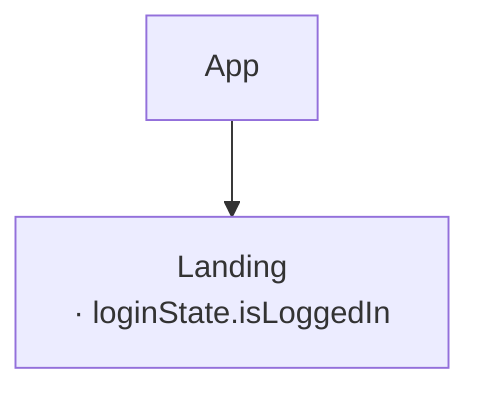
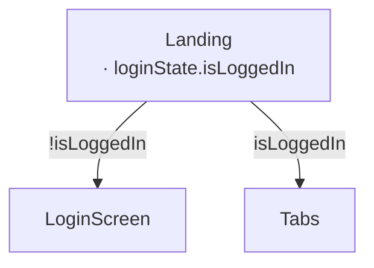
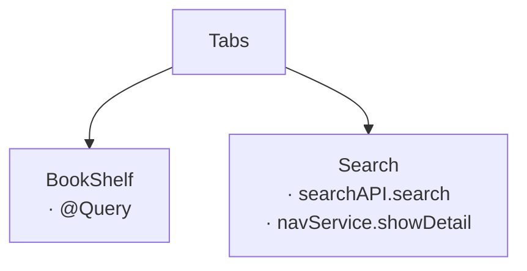
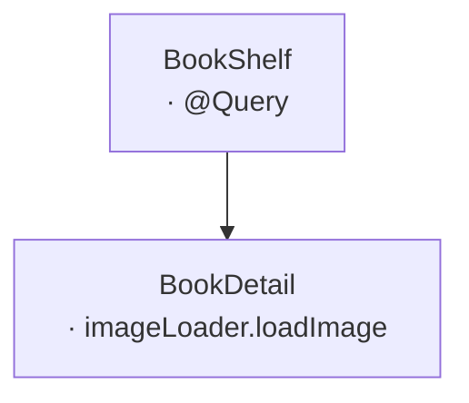
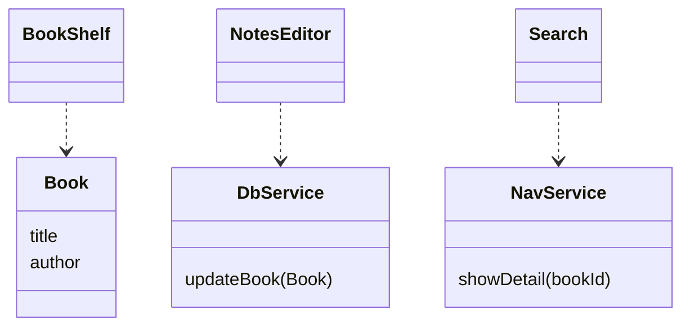
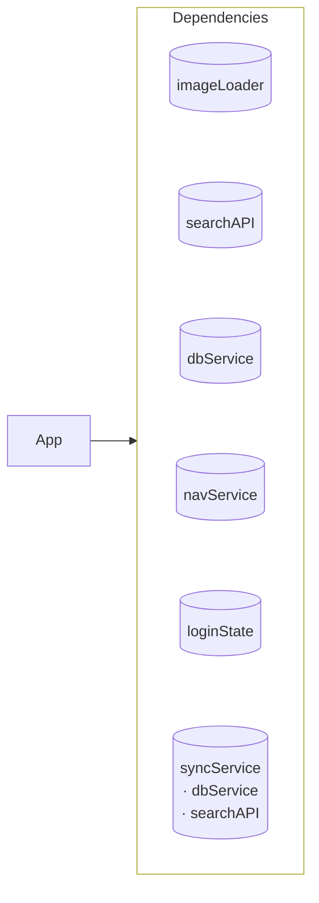
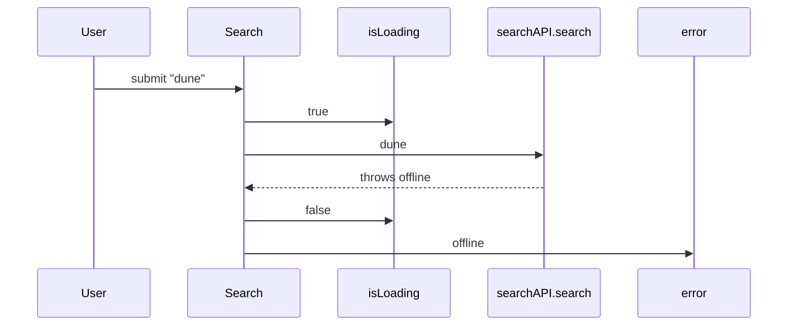

# hypermodular — Top-Down Development behavioral mapping

TDD means **Top-Down Development**: the app is modeled as a tree of
behavior before it is built; development flows from the root toward the
leaves; each node's evidence is declared before its code. The map is
Mermaid in markdown (`APP-MAP.md` at the repo root, `MAP.md` beside each
mapped subtree), so it renders in every GitHub/GitLab PR — always
visible, always diffable.

The map is behavioral, not an inventory: it shows where decisions live
and what they ask of the world, nothing else. Renaming a button never
touches it; moving a decision always does.

The architecture this produces is **hypermodular**: one mermaid is one
module is one boundary. No map knows more than one level, and the whole
app is reconstructable by merging nodes on their names — so the global
view is always derivable and never maintained.

## The three rules

1. **Build top-down.** Implement a node only after its parent exists.
   New features are drawn on the map before any code is written.
2. **Respect the map.** When working on a node, touch only that node's
   own code and the capabilities named in its own label. Needing one
   that isn't on the map means stopping and proposing a map change
   first — that diff is the design review.
3. **Evidence, not effects.** A node's behavior is declared as data:
   these values in, this evidence out — the ordered log of its I/O
   with payloads: every source-of-truth write and every boundary call,
   sync or `async throws` alike.
   Declare the evidence before
   implementing; implementation means making the declaration hold. Never
   observe effects behind a boundary, never simulate behavior (no
   mocks): a boundary in a spec is a logger, and checking a node is
   comparing two values.

## One law: depth 1 — the cure for death by a thousand mocks

Every artifact describes exactly one boundary — its own. A logged
boundary never simulates deeper than one step. Injection enters only at
the root. And a map draws only one level: a node and its immediate
children. This is what keeps all three honest.

## Diagram 1: the structure tree

A `flowchart TD`, one level deep.

- **Solid arrow `-->`** = data flow. Parent hands the child its data,
  bindings, and callbacks; the child never reaches up or sideways.
  Cross-feature arrows are forbidden — features communicate through
  data and capabilities (navigation goes through `navService`; which
  node answers a route is composed up the tree).
- **Mermaid id = node name, always.** Write
  `BookShelf["BookShelf<br/>· @Query"]`, never a short alias id.
  The name is the join key that merges maps back into one tree; ids
  that differ from names break the merge silently. Redundant to type,
  free for an AI.
- **Node label = name on the first line, then one contract line per
  line**, using `<br/>`. **Every contract line starts with `· `**
  (middle dot, space): the name is the text before the first `·`, so
  the merge key stays unambiguous even where `<br/>` doesn't render.
  Three kinds of contract line, distinguishable at a glance and by
  parser — `@` materializes, a dot calls, a bare name calls back:
  - `· @Source` lines **materialize**. The `@` is the materialize
    marker; the word is the source's own name — a property wrapper
    (`· @Query`, `· @AppStorage`, `· @FocusState`), or `· @ProcessInfo`
    for ambient launch input. Source name only, written once however
    many keys the node holds; what the node derives from it (an
    isLoggedIn computed off a token) is code's business, not the
    map's. A wrapper earns a line only when it binds the node to a
    source of truth that **outlives the node** — a store, defaults,
    system state such as focus. Machinery whose whole lifetime is the
    node's — own state, gesture transients, task handles — gets no
    line, whatever its spelling.
  - `· <dep>.<func>` lines **call** a capability from the dependency
    box (`· dbService.updateBook`).
  - `· name` lines (no `@`, no dot) **call back**: a closure the parent
    handed down as data (`· onSave`). It appears in the parent's map,
    where it is handed down, and in the node's own — like any contract
    line.

  Calls and callbacks produce evidence; materialized *reads* don't —
  though a write to materialized storage is I/O and logs like any
  write (see Declaring evidence). The lines under the name are the
  node's entire outbound relationship with the world: everything it
  materializes, calls, or calls back. A name-only label receives
  everything and calls nothing. Nothing else ever goes in a label.
- **A node is a collapsed subtree.** The screen plus all its view
  furniture (rows, buttons, design-system pieces) is one node; internal
  attribution is meaningless — the node's contract is what crosses its
  edge. A subtree becomes its own node only when it joins the app
  lifecycle independently: own outliving state, appearance work,
  navigation destination, or its own boundary call. View modifiers
  follow the same rule: a modifier is a node only if it carries
  contract lines; one with own state alone is furniture.
- **A decision marks its alternative arrows with the deciding value.**
  No diamonds — deciding is what nodes do — but alternatives are
  structural: an agent must know whether children coexist or exclude
  each other. Unlabeled solid arrows = composition (children exist
  together); labeled arrows = alternatives, labeled with the value that
  selects them (`-->|isLoggedIn|`, `-->|!isLoggedIn|`), which the
  node's contract line already names (`loginState.isLoggedIn`). The
  label states possibility, never sequence — what happens is the
  evidence log's business.
- **Unbuilt nodes are bare leaves** — mapped, reachable, empty. The map
  runs ahead of the code; a leaf with no insides is finished design.
- Shell/core split (imperative shell hosting the machinery, pure core
  taking values and closures — CoreFlow style) is implementation detail
  and never drawn.

One module = one mermaid, chopped at every level. A node carries its
full contract everywhere it appears — as a child in its parent's map and
as the root of its own. The duplication is deliberate: it's double-entry
bookkeeping. Every block opens with a `%%` comment declaring its place,
so an extracted mermaid still knows where it belongs. The root map:



Landing's map (the login gate — a decision node):



Tabs' map (unlabeled arrows — plain composition):



BookShelf's map, beside its code:



Leaves get no structure map of their own — we are modeling data flow,
and a map earns its existence by having arrows: flow to show. A leaf
has no internal flow; its contract lives in its parent's map (its only
structural appearance), and the day a leaf grows children, its
structure map is born together with them. A leaf whose evidence crosses
its edge does get a `MAP.md` — holding evidence blocks only (Diagram 4);
those are arrows too.

Merging these on their shared node names reconstructs the whole tree —
the hypermodular property, demonstrated.

## Diagram 2: the data coupling layer

A `classDiagram` of the shared vocabulary: models and service
signatures. Field names without elaboration; services as bare closure
signatures; `..>` records consumption. Coupling is consumption, not
visibility — everything is visible to everyone, and only use creates a
line.



Read it diagnostically: modules sharing many types are secretly one
module; a type referenced everywhere is core domain, expensive to change.

## Diagram 3: dependencies

The world's surface and one fact about it: the root injects all of it.
No usage lines — usage is written on the nodes themselves (Diagram 1).

- Cylinders are surfaces nodes must **call**: writes and commands
  (`dbService` is writes only), non-native fetches (`imageLoader`,
  `searchAPI`), capabilities (`navService` — closures over root-owned
  navigation state). Native materialization (`@Query`, `@AppStorage`)
  is not a dependency: it's facts arriving, tagged in the node label.
  How a capability's closure is assembled behind its cylinder —
  root-owned state, a derived service, listeners registered up the
  tree — is implementation detail and never drawn.
- **A dependency is an environment value: a plain struct composed of
  closures, lets, or bindings.** Pure value, no protocols, no classes,
  no reference-type service objects — capabilities as closures, facts
  as lets, shared mutable state as bindings, mixed freely in one
  struct. The live implementation, the preview stub, and the logging
  spec host are just different member sets of the same struct.
  Injection means putting a value into the environment; deriving means
  building a new value from values already there. Nothing else.
- Name the boundary, not the tech: `dbService`, not `swiftData`.
- **Injection is normal data flow.** One solid arrow `-->` from the
  root into the Dependencies box: App hands values to the environment,
  the same way a parent hands values to a child. A second arrow into
  the box means injection leaked into the tree.
- **The column is ordered: top to bottom is injection order.** The
  invisible `~~~` chain is semantic, not layout — injectors are
  typically view modifiers applied in sequence, and a later injector
  may read services already in the environment and combine them into a
  new one. A **derived service** uses the node-label grammar: name on
  the first line, then one line per ingredient it reads —
  `syncService[("syncService<br/>· dbService<br/>· searchAPI")]`. Its
  ingredients must appear **above it** in the column; an ingredient
  below is an order violation you can see. The injector modifiers
  themselves are implementation detail and never drawn.
- `fill:none` on every box; stack cylinders with invisible `~~~` links.



The box's size is a health metric on its own.

## Combining maps (identity rules)

Depth-1 maps must recombine into one tree mechanically. Any agent (or
script) must be able to answer "which node belongs where" from the files
alone:

- **One name, one node.** Node display names are globally unique across
  the whole app and identical everywhere the node appears: as a leaf in
  its parent's map and as the root of its own. The name is the join key.
- **One tree per entry point.** A repo with several `@main` targets
  holds one tree per target in `APP-MAP.md`, each with its own
  `%% Root:` block; names are unique across the repo, not the tree. A
  component that is built but mounted by no root is listed under a
  `## Unmounted` heading in a block headed `%% Root: App · Unmounted` —
  name and full label, no arrows — so its contract has a copy to
  compare against the day it mounts.
- **Same contract everywhere — deliberately duplicated.** A node's full
  label (name + contract lines) is identical as a child in its parent's
  map and as the root of its own. This is double-entry bookkeeping: the
  reconstruction check compares the copies, and any mismatch is a
  detected, unreviewed design change — single-sourcing would have
  nothing to compare. Changing a contract therefore touches parent map
  and child map in the same commit, which is exactly the design review.
- **A map exists only where there are arrows.** Nodes with children get
  a structure map; leaves don't — a leaf's contract lives in its
  parent's map, its only structural appearance. (Label duplication
  applies only to nodes that appear twice; a leaf has one entry, so
  nothing to cross-check.) Evidence blocks are arrows as well: any node
  with a required evidence block has a `MAP.md`, structure or not.
- **Every mermaid block declares its place** as its first line, inside
  the block: `%% Root: BookDetail · Parent: BookShelf (../MAP.md)` for
  structure, `%% Evidence: BookDetail · Parent: BookShelf (../MAP.md)`
  for evidence. The root map's comment is `%% Root: App`. The block
  stays self-contained when extracted; following parent links upward
  reaches `APP-MAP.md`, following names downward reaches any node.
- **Reconstruction check**: parent links form a single tree with no
  orphans, and every `MAP.md` — structure or evidence-only — is
  reachable. When maintaining maps, verify this before committing:
  `scripts/mapcheck.py <repo>` runs it, with id = name, the `·`
  grammar, label double-entry, every call line naming a cylinder,
  injection order, evidence targets against labels, and reserved-word
  quoting. What it cannot see is code — whether every call in a node's
  Swift is on its label, and whether a bare evidence target is a real
  stored property — and it says so.

## Declaring evidence

A node's declared behavior is one value: the evidence log — the ordered
`(name, payload)` record of its I/O. Two kinds of entry, nothing else:

- **A source-of-truth mutation logs** under the property's name: a
  binding write, an external-storage write, the node's own state write.
  Evidence is wider than the map contract — own state never appears on
  a map, but its writes are I/O, and I/O logs.
- **A boundary call logs** under the closure's name, with its
  arguments — whatever the closure's shape: a fire-and-forget command,
  an `async throws` fetch, a returning query to the world. Impurity is
  visible in the signature (Wlaschin): `async` and `throws` mark the
  world-crossing that makes a closure a boundary rather than a pure
  helper. The call is the event; what comes back — a value or a thrown
  error — is supplied data, not evidence.

**Reads never log.** A query's answer is data handed in, and getters
fire on the render scheduler's timing, not the node's — one
nondeterministic line poisons an exact-sequence assertion. Binding
getters, view-builder closures, any helper evaluated during rendering:
none of it is evidence.

The test for a write is **whose source of truth it lands in**, never
who holds the pen. A write into state the node owns or was handed — own
state, a binding, external storage — is the node's I/O and logs, even
when the system performs it on the user's behalf: a text field writing
`title` through its binding logs every keystroke; a toggle writing
`sortDescending` into storage logs. State the system owns and the node
merely views — focus — is not the node's source of truth: the system
moving focus is data arriving, no entry; the node setting `isFocused`
is asking the system for something, a boundary call wearing a
property's name, and it logs as one.

A declaration is an acceptance criterion transcribed into the log's
vocabulary: *given* names constructor arguments, *when* names an
interaction, *then* names the log. "Given no connection, when the user
searches, then it reports offline and writes no books" is a
construction, a stimulus, and one equality check:

```
["isLoading true", "search dune", "isLoading false", "error offline"]
```

When the log crosses the node's edge, the declaration is drawn
(Diagram 4) and the array is its test form; when it touches own state
only, the array in the test is the whole declaration.

Discipline that keeps the log honest:

- Assert order only when the requirement names an order; interchangeable
  events are a set; if only the final decision matters, assert the
  decision.
- Silence is evidence — no `books` entry means the failure wrote
  nothing.
- Payloads are deterministic: when a value's description isn't
  snapshot-stable, declare a symbolic payload for it.
- Pin the material as-is: a text field that writes its binding twice
  per keystroke logs twice per keystroke. Evidence records what
  happens, not an idealization.
- A workflow is a rule: when a later step consumes an earlier step's
  result, or a failure needs compensation, model that protocol as its
  own node — a flat happy-path log is not it.

The log is complete by construction: a node's write is the last thing
it ever does — it dies in the wave it triggers, and the result arrives
as its successor's creation inputs. The network is reactive so the
nodes don't have to be.

One integration test per cylinder, at the shell, written once, owns
each boundary's real implementation. A node's evidence proves only the
decision to cross the boundary — never what lies behind it.

## Diagram 4: evidence

One `sequenceDiagram` per acceptance criterion whose log crosses the
node's edge — at least one entry targets a contract line. A criterion
whose log is own state only stays an array in the test and is not
drawn: the map shows edges, and behavior that cannot break a contract
has nothing to show on it. "Optional" means *own state only*, never
"skipped" — a node with a call on its label and no evidence block is a
finding, like a label mismatch.



- **Two comment lines open the block.** `%% Evidence: <Node> · Parent:
  <Parent> (../MAP.md)` places it — the same parent link every block
  carries, so an evidence-only `MAP.md` is never an orphan (an unmounted
  node's parent is `Unmounted (../APP-MAP.md)`). `%% Given:
  <construction>` states the given: constructor arguments and stubs.
- **Arrows into the node are the *when***: `User->>Node: interaction`
  for input, `System->>Node: event` for lifecycle, scene phase, deep
  links. Never a log entry.
- **Arrows out of the node are the *then***: `Node->>target: payload`
  is one entry, `(target, payload)`, in order. The array the test
  asserts is exactly the ordered list of out-arrows, nothing else.
- **Dashed arrows back are supplied data**: `target-->>Node: value` or
  `throws` — drawn only when it explains a later entry. Never an entry.
  The call is the event; what comes back is data.
- **Targets are the node's edge and nothing else**: a contract line
  (a capability call, a callback) or a stored property of the node —
  own state, or a materialized source being written. Any other target
  is a finding — a grandchild on a lifeline is depth 2, visible.
- **`loop` when the requirement names no count**, exactly as order is
  asserted only when the requirement names an order; the test then
  asserts the decision. A value the requirement doesn't pin is a
  **symbolic payload** (`max so far`) — a separate choice; a loop can
  carry pinned payloads, and a single arrow can carry a symbolic one.
- **Silence is drawn**: a stimulus with no out-arrow asserts that
  nothing logged; `Note over Node: …` says why.
- **Quote a target whose name mermaid reserves** — `title`, `loop`,
  `end`, `note`, `over`, `and`, `off`, `option`, and the rest of the
  sequence-diagram vocabulary (`alt`, `opt`, `par`, `rect`, `box`,
  `break`, `critical`, `participant`, `actor`, `activate`,
  `deactivate`, `create`, `destroy`, `link`, `links`, `properties`,
  `details`, `autonumber`, `else`): `Node->>"title": Dune`. The name is
  the text inside the quotes, the same way it is the text before the
  first `·` on a label.

Blocks live in the node's own `MAP.md`, under `## Evidence`, after the
structure block if there is one. Evidence appears once — the parent's
map stays structure-only. The block is the source and the test is
written from it; the two are double-entry like a label and its copy:
contracts are duplicated on purpose, and single-sourcing would have
nothing to compare. A diagram and a test array that disagree are an
unreviewed behavior change.

## Workflows

**Reverse-engineering an existing project.** Walk the instantiation
graph from the entry point downward (solid arrows). Find every I/O
touchpoint — network, storage, DI/environment, timers, notifications —
and attribute each call to the node that decides it (its contract
lines); each service becomes a cylinder. Apply the cuts while
walking; don't inventory first. Collect shared models and service
signatures into the coupling diagram. Verify injection happens only at
the root; flag violations as findings. Write the maps depth-1 with
identity headers. Evidence is not reverse-engineered: draw a block only
where the code already carries a pinned log (an existing test) — never
invent criteria from code; a node with calls on its label and no block
is a finding to report, not to fill. Then present the two or three most
interesting things the maps reveal — the first map of a codebase is a
free architecture review.

**Starting a new app or feature.** Draw before building; iterate on the
diagram with the user — it's cheap, that's the point. Unbuilt leaves are
finished design. Once agreed, build root-down, each node's evidence
declared before its code — drawn (Diagram 4) where it crosses the edge,
an array in the test where it is own state only. New features enter the map first, and the map
diff is the design review.

**Maintaining.** The map is code: any change that moves a decision,
changes a contract, adds a capability, or changes what a node does at
its edge updates the affected maps — structure or evidence — in the
same commit. In a mapped repo, read `APP-MAP.md` before reading
code, and treat rule 2 as the work fence. If map and reality disagree,
say so and fix one of them — never silently work around.

## Style

Ids are names — the merge key — and labels carry the contract. No
colors, no emoji, no fills, no status markers — whether a node's
declared evidence holds is the only "done" that exists, and it lives in
the repo, not the map.

## References

- [SwiftUI Data Flow Masterclass](https://medium.com/@redhotbits/swiftui-data-flow-masterclass-099f0768f776)
  — the data-flow model this method rests on: nodes, waves, boundary
  events, execution-log testing.
- [TDD Is Dead. Long Live TDD.](https://medium.com/@redhotbits/tdd-is-dead-long-live-tdd-f85b4b9eacbd)
  — the method: lift state and services, lock the core with evidence,
  delegate the detail.
- [swift-core-flow](https://github.com/sisoje/swift-core-flow) — the
  mechanics: macros for the shell/core split and evidence logging.
- [swiftui-mv-architecture](https://github.com/redhotbits/swiftui-mv-architecture)
  — the style: what a node's implementation looks like.
