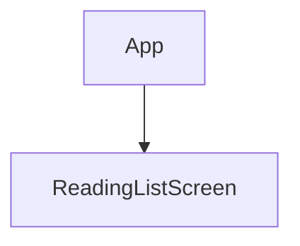
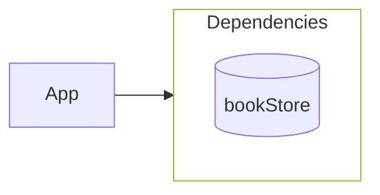
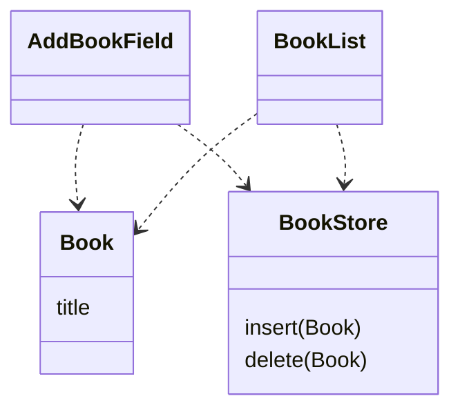
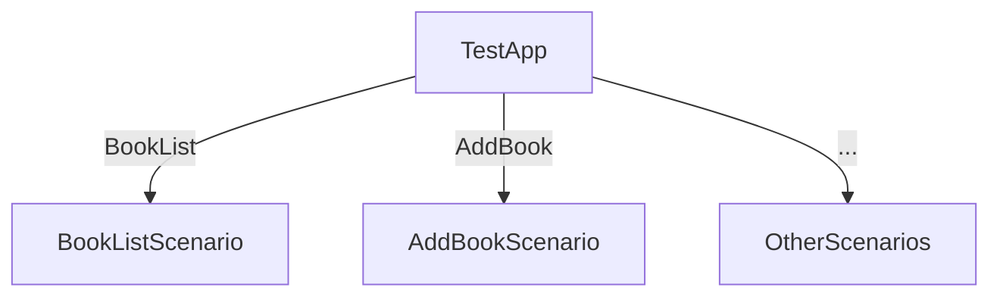

# Validation: mapping CoreFlowExample with the skill as-is

The exercise TODO item 1 asked for: apply the map grammar to
`~/dev/CoreFlow/CoreFlowExample` (ground truth in its `SPEC.md`) and record
where the notation creaks. The maps below are ready to drop into that repo;
the findings are the deliverable.

## The maps

CoreFlowExample has two `@main` entry points over one library. The shipped
app first.

### APP-MAP.md (RealApp)

One cylinder. `bookStore` is assembled by the `LiveBookStore` modifier from
`modelContext` — and the skill's rule that how a capability is assembled
behind its cylinder is *implementation detail, never drawn* absorbed this
cleanly: the `ModelContext` class, the injector modifier, the
`.modelContainer` call all stay off the map, and the injected value itself
(`BookStore`, a struct of closures) is exactly the "plain struct composed of
closures" the skill demands. Validation pass, no friction.

### MAP.md beside ReadingListScreen

Leaves — no maps of their own. `ReadingListScreen` is a name-only label:
pure composition, receives everything, calls nothing. Correct and legible.

### Data coupling layer

Read diagnostically, as the skill instructs: both children consume both
types — the pair is close to "secretly one module," which matches reality
(they ship composed, tested apart).

### Evidence declarations (transcribed from the UI-test ground truth)

- **AddBookField** — given an empty title, when the user types "Dune" and
  taps Add, then: ten `title` writes (TextField's real binding writes twice
  per keystroke plus two focus writes — pinned as-is), `insert Dune`, `title
  ""` (the clear).
- **BookList** — given `[Dune, Anathem]`, when the user toggles sort and
  deletes Anathem, then: `["sortDescending true", "delete Anathem"]`.

## Where the doctrine already held (report these as passes)

The evidence chapter was co-developed with this example and it shows —
three of its discipline lines are satisfied by the SPEC verbatim:

1. **"Pin the material as-is"** — the double-write-per-keystroke log is the
   canonical case, and the SPEC pins it.
2. **"The test is who fired it"** — FocusField is a working proof: the
   system's focus move through the real `FocusState.Binding` logs nothing;
   the button's programmatic write logs. The skill sentence and the test
   assert the same thing.
3. **"Assert order only when the requirement names an order"** —
   DragCard's timing-dependent values get behavior asserts, no log
   snapshot; DownloadButton's deterministic cancel order gets the full
   sequence. The SPEC applies the distinction exactly.

Depth-1 held everywhere: no map needed a second level, no boundary needed
to simulate past itself, injection enters once.

## Findings — where the notation creaks

### F1 — Two roots, one repo (the biggest gap)

The skill assumes one root per repo (`APP-MAP.md` at the repo root, `%%
Root: App`). CoreFlowExample has two `@main` targets over one library:
`RealApp` and `TestApp`. Worse, six of the eight components (DragCard,
TrickyDragCard, FocusField, Dimmer, SaveButton, DownloadButton) are
**unreachable from the shipped app's root** — they exist in the library,
tested, but composed nowhere in RealApp. The grammar has no place for a
built-but-unmounted component: "unbuilt leaves" covers the inverse case
(mapped, not built), not this one (built, not mapped).

**Proposed ruling.** `APP-MAP.md` may hold one tree per `@main`, each with
its own `%% Root:` block; node names stay globally unique across all trees
(the merge key namespace is the repo, not the tree). A library component
reachable from no root is listed under a `## Unmounted` heading — name and
full contract line, no arrows — so the double-entry check still has one
copy to compare when the component later mounts.

### F2 — A decision with no contract line to name its value

`TestApp` is a genuine decision node — nine alternatives selected by the
`SCENARIO` launch variable — and mapping it is natural:

But the skill requires the deciding value to be "already named" by a
contract line, and the decider here is `ProcessInfo.environment` — neither
an `· @Wrapper` materialization nor a `· dep.func` call. The grammar has
two kinds of contract line and this value fits neither.

**Proposed ruling.** Ambient process inputs (launch environment, arguments)
are materialization: a `· ProcessInfo` line, wrapper-name-only spirit. They
are facts arriving, not a dependency — nothing to inject, nothing to mock.

### F3 — Parent-supplied closures have no label form

`SaveButton` takes `onSave` and `getUserName` as plain `let` closures from
its parent — not environment capabilities. The call grammar is
`· <dep>.<func>`; there is no dep to prefix. The current text resolves this
implicitly — the label is "the node's entire relationship with the world
*beyond its parent*," and a parent-handed callback is the parent's data
flow — but then a node whose evidence logs `onSave` and `getUserName`
carries a name-only label, and the map undersells its I/O.

**Proposed ruling.** A third contract-line kind, distinguishable by parser
like the other two: a bare `· name` (no `@`, no dot) is a parent-supplied
callback. `@` = materialize, dot = capability call, bare = callback. The
double-entry duplication then shows the callback in both the parent's map
(where it is handed down) and the node's own.

### F4 — ViewModifier hosts (resolves cleanly, worth one sentence)

`Dimmer` is a `ViewModifier` with own state only — no materialization, no
calls. Under the existing rules it is invisible on maps (own state never
appears; a node earns a label line only by contract), and `LiveBookStore`,
the injector modifier, is already ruled invisible. So modifiers never
appear on maps unless they carry contract lines — which the skill implies
but never states. One sentence in Diagram 1 would close it.

### F5 — `@AppStorage`: the skill and CoreFlow name it differently

The skill maps `@AppStorage` as native materialization ("not a
dependency: it's facts arriving"). CoreFlow's substitution table treats it
as external storage — an injected `@Binding` dependency in tests. These are
answers to different questions (what the map shows vs. how the test
constructs), not a contradiction — but the two documents use "dependency"
for different sets, and an agent holding both will trip. The vocabulary
table (TODO 3) should pin it: *on the map, native materialization; in the
scenario, injected backing.*

### F6 — Wrapper-name-only labels can collide (open, low priority)

`· @AppStorage` names the wrapper, not the key. A node holding two
`@AppStorage` keys writes the same line twice. No instance in this example
(BookList and FocusField each hold one key, in different nodes); noting it
before it bites. Possible escape: allow `· @AppStorage(key)` only when a
node holds two of the same wrapper.

## Appendix: vocabulary alignment (toward TODO 3)

| Skill term | Trilogy term (TheOtherTDD.md Vocabulary) | Same? |
|---|---|---|
| evidence log | **execution log** — the ordered record of boundary events, every write and call with its payload | Same concept, two names. Pick one; the article's is published. |
| boundary call / source-of-truth write | boundary event | Article's is the umbrella; skill splits it into its two kinds. Compatible. |
| depth 1 | **mock depth** constant at one | Same law; the skill generalizes it to maps and injection. |
| scenario | **scenario** — a small test-host view owning real `@State`, handing down only logged boundaries | Identical. |
| shell (never drawn) | **shell** — the view owning live wrappers and services | Identical; skill adds "never drawn." |
| data coupling layer (Diagram 2) | **data coupling layer** — the one shared module, free of behavior | Identical; the diagram is named after it. |
| capability / cylinder | dependency parameterization — closures at the boundary | Cylinder is the map-side name for the parameterized surface. |
| materialization | dependency rejection — data at the boundary, values in | Close kin: both are "facts arriving, nothing to simulate." |

The one real decision: **evidence log vs. execution log**. Everything else
aligns. The article is published under "execution log"; the skill's
frontmatter already says "evidence (execution-log) spec" — the alignment
costs one rename in the skill or one alias in the table.
