# Validation: mapping CoreFlowExample with the skill as-is

The exercise TODO item 1 asked for: apply the map grammar to
`~/dev/CoreFlow/CoreFlowExample` (ground truth in its `SPEC.md`) and
record where the notation creaks. The findings are the deliverable.

CoreFlowExample has since been removed from CoreFlow (`4cdfdb8`; its
hosted suite owns every live claim now). The eight logs it pinned
survive here, transcribed in Part 2, and its validated maps in
`../scripts/fixtures/clean`. Nothing below should send a reader to that
repo.

## The maps

CoreFlowExample has two `@main` entry points over one library. The
shipped app first.

### APP-MAP.md (RealApp)

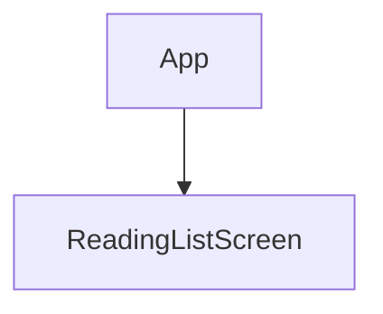

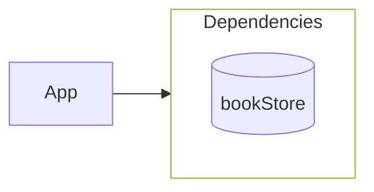

One cylinder. `bookStore` is assembled by the `LiveBookStore` modifier
from `modelContext`, and the skill's rule that how a capability is
assembled behind its cylinder is implementation detail, never drawn,
absorbed this cleanly. The `ModelContext` class, the modifier, and the
`.modelContainer` call all stay off the map, and the value itself
(`BookStore`, a struct of closures) is exactly the "plain struct
composed of closures" the skill demands. Validation pass, no friction.

### MAP.md beside ReadingListScreen

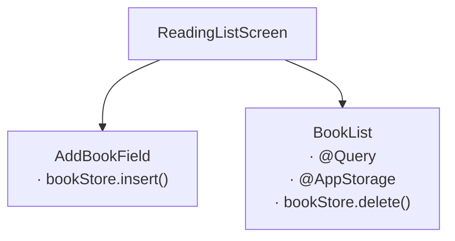

Leaves, so no maps of their own. `ReadingListScreen` is a name-only
label: pure composition, receives everything, calls nothing. Correct
and legible.

### Data coupling layer

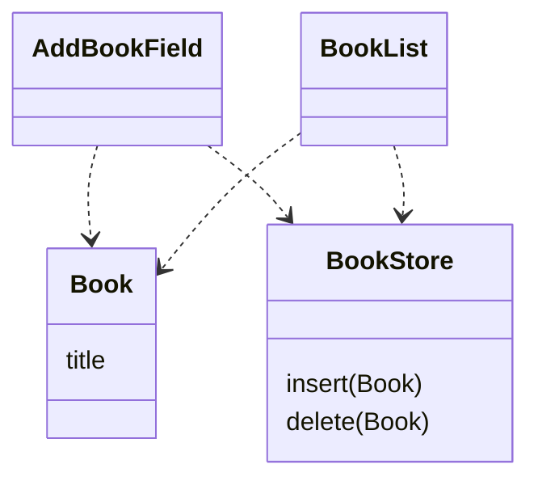

Read diagnostically, as the skill instructs: both children consume both
types. The pair is close to one module in disguise, which matches
reality (they ship composed, tested apart).

### Evidence declarations (transcribed from the UI-test ground truth)

- **AddBookField.** Given an empty title, when the user types "Dune" and
  taps Add, then: ten `title` writes (TextField's real binding writes
  twice per keystroke plus two focus writes, recorded as-is), `insert
  Dune`, `title ""` (the clear).
- **BookList.** Given `[Dune, Anathem]`, when the user toggles sort and
  deletes Anathem, then: `["sortDescending true", "delete Anathem"]`.

## Where the doctrine already held (report these as passes)

The evidence chapter was co-developed with this example and it shows.
Three of its discipline lines are satisfied by the SPEC verbatim.

1. **"Record the behavior as-is."** The double-write-per-keystroke log
   is the canonical case, and the SPEC pins it.
2. **"The test is who fired it"** (superseded by F7 below, which
   corrects the criterion). FocusField is a working proof. The
   system's focus move through the real `FocusState.Binding` logs
   nothing. The button's programmatic write logs. The skill sentence
   and the test assert the same thing.
3. **"Assert order only when the requirement names an order."**
   DragCard's timing-dependent values get behavior asserts, no log
   snapshot. DownloadButton's deterministic cancel order gets the full
   sequence. The SPEC applies the distinction exactly.

Depth-1 held everywhere. No map needed a second level, no boundary
needed to simulate past itself, and values are set at the root once.

## Findings: where the notation creaks

### F1: two roots, one repo (the biggest gap)

The skill assumes one root per repo (`APP-MAP.md` at the repo root,
`%% Root: App`). CoreFlowExample has two `@main` targets over one
library, `RealApp` and `TestApp`. Worse, six of the eight components
(DragCard, TrickyDragCard, FocusField, Dimmer, SaveButton,
DownloadButton) are unreachable from the shipped app's root. They exist
in the library, tested, but composed nowhere in RealApp. The grammar
has no place for a built-but-unmounted component. "Unbuilt leaves"
covers the inverse case (mapped, not built), not this one (built, not
mapped).

**Proposed ruling.** `APP-MAP.md` may hold one tree per `@main`, each
with its own `%% Root:` block. Node names stay globally unique across
all trees (the merge key namespace is the repo, not the tree). A
library component reachable from no root is listed under a
`## Unmounted` heading, name and full contract line, no arrows, so the
double-entry check still has one copy to compare when the component
later mounts.

### F2: a decision with no contract line to name its value

`TestApp` is a genuine decision node, nine alternatives selected by the
`SCENARIO` launch variable, and mapping it is natural:

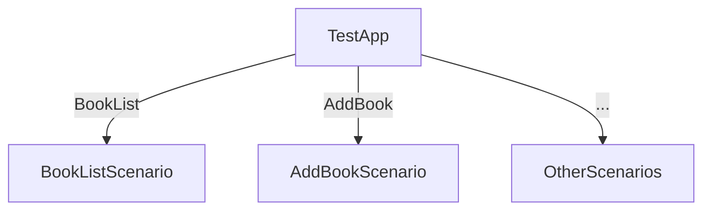

But the skill requires the deciding value to be "already named" by a
contract line, and the decider here is `ProcessInfo.environment`,
neither an `· @Wrapper` materialization nor a `· dep.func` call. The
grammar has two kinds of contract line and this value fits neither.

**Proposed ruling.** Ambient process inputs (launch environment,
arguments) are materialization: a `· ProcessInfo` line, in the
wrapper-name-only spirit. They are facts arriving, not a dependency.
Nothing to set at the root, nothing to mock.

### F3: parent-supplied closures have no label form

`SaveButton` takes `onSave` and `getUserName` as plain `let` closures
from its parent, not environment capabilities. The call grammar is
`· <dep>.<func>`. There is no dep to prefix. The current text resolves
this implicitly (the label is "the node's entire relationship with the
world beyond its parent", and a parent-handed callback is the parent's
data flow), but then a node whose evidence logs `onSave` and
`getUserName` carries a name-only label, and the map undersells its
I/O.

**Proposed ruling.** A third contract-line kind, distinguishable by
parser like the other two. A bare `· name` (no `@`, no dot) is a
parent-supplied callback. `@` materializes, a dot is a capability call,
bare is a callback. The double-entry duplication then shows the
callback in both the parent's map (where it is handed down) and the
node's own.

### F4: ViewModifier hosts (resolves cleanly, worth one sentence)

`Dimmer` is a `ViewModifier` with own state only. No materialization,
no calls. Under the existing rules it is invisible on maps (own state
never appears; a node earns a label line only by contract), and
`LiveBookStore`, the modifier that sets the store, is already ruled
invisible. So modifiers never appear on maps unless they carry contract
lines, which the skill implies but never states. One sentence in
Diagram 1 would close it.

### F5: `@AppStorage`, which the skill and CoreFlow name differently

The skill maps `@AppStorage` as native materialization ("not a
dependency: it's facts arriving"). CoreFlow's substitution table treats
it as external storage, a `@Binding` supplied in tests. These are
answers to different questions (what the map shows versus how the test
constructs), not a contradiction, but the two documents use
"dependency" for different sets, and an agent holding both will trip.
The vocabulary table (TODO 3) should pin it: on the map, native
materialization; in the scenario, supplied backing.

### F6: wrapper-name-only labels can collide (open, low priority)

`· @AppStorage` names the wrapper, not the key. A node holding two
`@AppStorage` keys writes the same line twice. No instance in this
example (BookList and FocusField each hold one key, in different
nodes); noting it before it bites. Possible escape: allow
`· @AppStorage(key)` only when a node holds two of the same wrapper.

## Appendix: vocabulary alignment

Ruled and promoted to `SKILL.md`, "Vocabulary". The one real decision
was evidence log (the skill) versus execution log (the masterclass, the
method article, CoreFlow). The log is the execution log. Evidence stays
the name of what the test wants and of the block that declares it
(`%% Evidence:`), which the checker parses.

---

# Part 2: evidence as sequence diagrams

The map has three structure diagrams and no behavior diagram. Evidence
is prose plus an array literal. The candidate fourth diagram is a
mermaid `sequenceDiagram` per acceptance criterion. Before it becomes
doctrine, the same test as Part 1: transcribe CoreFlowExample's eight
pinned UI-test logs (ground truth: the logs its `SPEC.md` pinned,
transcribed below) and record where the notation creaks.

## The grammar as tested

- One block per acceptance criterion. First line is the identity
  comment: `%% Evidence: <Node> · Given: <construction>`.
- **Arrows into the node are the *when*.** `User->>Node: interaction`
  for user input. `System->>Node: event` for lifecycle, scene phase,
  deep links. Never a log entry.
- **Arrows out of the node are the *then*.** `Node->>target: payload`
  is one log entry, `(target, payload)`, in order. The array the test
  asserts is exactly the ordered list of out-arrows, nothing else.
- **Dashed arrows back are supplied data.** `target-->>Node: value` or
  `throws`, the given for whatever follows, drawn only when it explains
  a later entry. Never a log entry. Solid versus dashed is already the
  doctrine's call-is-the-event / return-is-data distinction.
- **Targets are the node's edge and nothing else:** a contract line (a
  cylinder call, a parent-supplied callback) or one of the node's own
  stored properties (a source-of-truth write). A target that is neither
  is a finding.
- **`loop` only when the requirement names no count**, the same way
  order is asserted only when the requirement names an order. A block
  containing a loop is a shape, not a pin. Its test asserts the decision
  the requirement names.
- **Silence is drawn.** A stimulus with no out-arrow is the assertion
  that nothing logged. A `Note over Node` says so in words.

Rendering checked with mermaid 11.16.0 (`@mermaid-js/mermaid-cli`), all
eight blocks: dotted participant names (`bookStore.delete`), hyphens in
messages, `""` payloads, `loop`, `Note over`, and dashed returns all
parse and draw. One thing did not. See F12.

## The eight logs, transcribed

### AddBookField

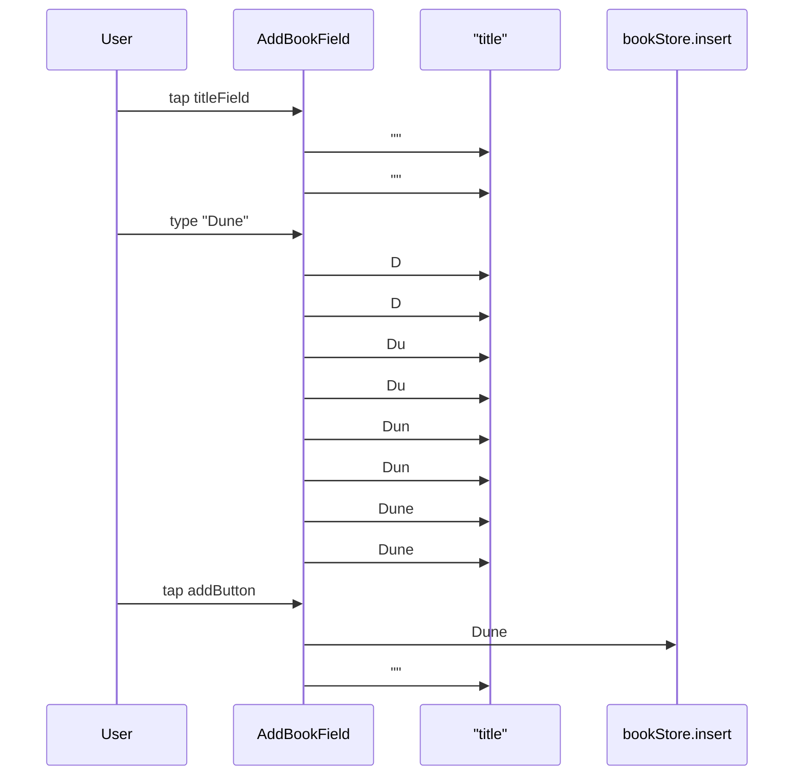

Twelve out-arrows. Read top to bottom they are the pinned array
`["", "", "D", "D", "Du", "Du", "Dun", "Dun", "Dune", "Dune", "Dune", ""]`
under names `title×10, insert, title`. No `loop`. The requirement pins
the count (twice per keystroke, as-is), so the block pins it too. Long,
and honestly so: fifteen lines for the most verbose log in the example.
`title` is quoted because mermaid reserves the word (F12). The name is
the text inside the quotes.

### BookList

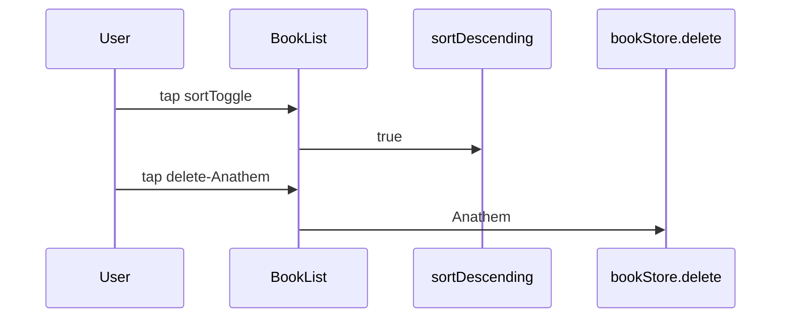

Array: names `["sortDescending", "delete"]`, values `["true",
"Anathem"]`. The `@Query` fact sits in the given header. It is supplied
data, never an arrow.

### Dimmer

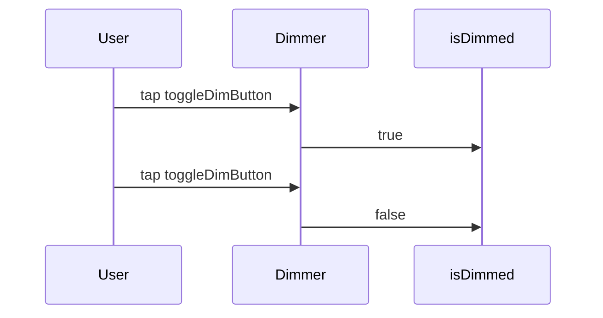

### SaveButton

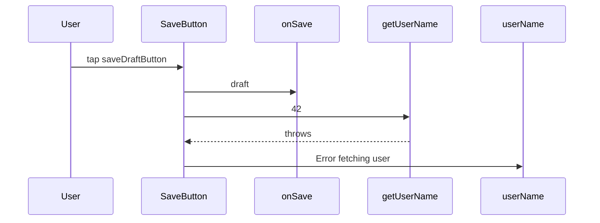

Array: names `["onSave", "getUserName", "userName"]`, values `["draft",
"42", "Error fetching user"]`. The dashed `throws` is not in the array.
It is the scenario's stub, drawn because it explains the last entry.
This is the block that shows why solid/dashed was worth having.

### DragCard

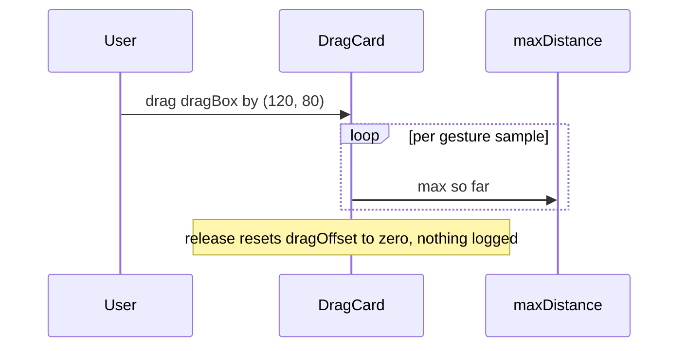

No array. `SPEC.md` pins no log here ("values are timing-dependent,
behavior asserts only"). The test asserts `current 0` and `max ≠ 0`
after release. The `loop` is the notation for exactly that. The
requirement names no count, so the block is a shape and the test
asserts the decision. `dragOffset` itself is `@GestureState`, copied
verbatim and never logged. It gets no lifeline.

### TrickyDragCard

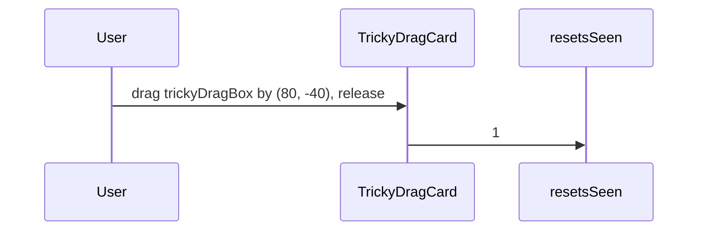

### DownloadButton

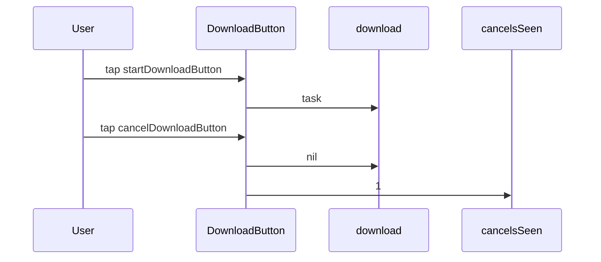

Array: names `["download", "download", "cancelsSeen"]`, values
`["task", "nil", "1"]`. The causal story (the `nil` write cancels the
live task, whose resumption writes `cancelsSeen` strictly later) is
code's business. The diagram carries only the order, which is what the
requirement names.

### FocusField

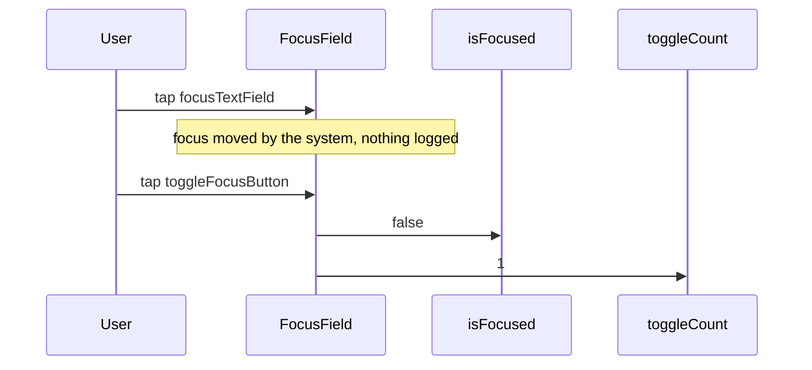

Array: names `["isFocused", "toggleCount"]`, values `["false", "1"]`,
and, before the second tap, the names are still `[]`. The first
stimulus has no out-arrow. Silence drawn.

## Where it held (passes)

1. **All eight transcribe.** Nothing in the ground truth lacked a form:
   exact pins, an unpinned shape, a silence, a thrown return.
2. **Solid/dashed is the doctrine's own distinction**, free. "The call
   is the event; what comes back is supplied data" was a sentence. In
   SaveButton it is two arrow styles.
3. **`loop` extends "assert order only when the requirement names it"
   to counts** without a new rule. DragCard loops, AddBookField does
   not, and the reason is the same sentence.
4. **Depth 1 is visible.** Every lifeline is the node's own edge. A
   grandchild on a lifeline would be a violation you can see, like an
   ingredient below its deriver in the dependency column.
5. **Given/when/then have places.** Header, in-arrows, out-arrows. The
   prose transcription rule in *Declaring evidence* becomes a layout.
6. **It is lossless.** The array is the ordered out-arrows,
   mechanically. Diagram and test are double-entry, like label and
   label.

## Findings

### F7: "who fired it" mispredicts; "whose source of truth" predicts

The doctrine's read/write criterion says writes "the system (not the
node) performs through a binding" do not log. Drawing the stimuli
exposed that this sentence gets AddBookField wrong. TextField's
keystroke writes through `$title` are system-performed writes through a
binding, and they log, ten of them, pinned. FocusField's system focus
move through `$isFocused` is the same kind of event and does not log.
"Who fired it" cannot tell them apart. Both were fired by the system on
the user's behalf.

What does tell them apart: whose source of truth the write lands in.
`title` is the node's own state. A write into it is the node's I/O
whoever holds the pen. Focus is the system's state. The node's
`@FocusState` is a view onto it. The system moving focus is data
arriving (a read, no entry). The node toggling `isFocused`
programmatically is the node asking the system for something, a
boundary call wearing a property's name, and it logs as one.

**Proposed ruling.** Replace the "who fired it" paragraph: a write logs
iff it lands in a source of truth the node owns or was handed, that is,
own state, a binding, external storage. A write to state the system
owns (focus) logs only when the node performs it, because that is a
call, not a write. Reads stay unlogged for the reason already given.
The diagram surfaced this because an in-arrow with no out-arrow demands
an answer. Prose never asked.

### F8: leaves now have a reason for a file

Part 1 left leaves without a map ("a map earns its existence by having
arrows"). Every one of the eight nodes above is a leaf, and every one
now has arrows, sequence arrows. Evidence has to live somewhere beside
the code it constrains, and a parent's `MAP.md` holding eight
children's criteria is the wrong place.

**Proposed ruling.** Evidence blocks live in the node's own `MAP.md`,
beside its code, under an `## Evidence` heading after the structure
block (if any). A leaf with declared evidence therefore does get a
`MAP.md`, holding evidence only. The arrows rule still holds, read
literally. The parent's map stays structure-only. Contract duplication
applies to labels, not to evidence, which appears exactly once.

### F9: evidence targets need the F3 ruling to be checkable

SaveButton's out-arrows go to `onSave` and `getUserName`,
parent-supplied closures, which Part 1 (F3) found have no label form.
Without F3, the "targets are the node's edge" check has nothing to
match them against and SaveButton's label stays name-only while its
evidence logs two calls. F3's proposed bare `· name` line is now
load-bearing twice. SaveButton's label becomes
`SaveButton · onSave · getUserName`, and the diagram's
lifelines match the label line for line.

### F10: materialized writes log under a name the label does not carry

BookList's out-arrow targets `sortDescending`. Its label line says
`· @AppStorage`. The target is the property, the label is the wrapper,
and the registry check cannot bridge them without reading code. This is
F6 again, with teeth. Wrapper-name-only labels were a style choice when
labels were the only artifact. With evidence naming properties, the
check either reads code for the node's stored properties (acceptable;
own state is code's business anyway) or the label carries the property
name for materialized lines (`· @AppStorage sortDescending`). Decide
with F6.

### F11: the registry check, as it can be written

Part 2 was partly about making rule 2 mechanical. With the diagram in
place, the check is three set comparisons per node, none needing a
judgement call:

1. every `Node->>target` in an evidence block has `target` in the label
   contract lines or the node's stored properties (from code, per F10);
2. every label contract line that calls (`· dep.func`, bare `· name`)
   names a cylinder in the dependency box or a closure the parent hands
   down;
3. every cylinder or callback invoked in the node's code appears as a
   label contract line.

A target failing (1) is a design change nobody reviewed or a typo. A
line failing (2) is an unmounted capability. A call failing (3) is rule
2 broken. All three are greps over artifacts the method already writes.
Not implemented here; recorded so the doctrine can promise only what
this list can deliver.

### F12: property names can collide with mermaid's own vocabulary

The first render of AddBookField failed. `AddBookField->>title: ""` is
a parse error, because `title` is a sequence-diagram keyword. The lexer
reserves `accDescr accTitle activate actor alt and as autonumber box
break create critical deactivate destroy details else end left link
links loop note off opt option over par participant properties rect
right title`. Tested as a bare target, `title`, `loop`, `end`, `note`,
`over`, `and`, `off`, `option` break, while `left`, `right`, `as`
happen to pass. It is context-dependent, so treat the whole list as
reserved. `title` is a common SwiftUI property name. This will bite
regularly.

Three escapes parse: `"title"` (renders with the quotes showing),
`$title`, and `AddBookField.title`. `$title` is wrong. In SwiftUI it
means the projected binding, and not every own-state write goes through
it. Qualifying every own property as `Node.property` is uniform with
`dep.func` (every target becomes `owner.member`) but costs the prefix
on every line, and the log name is `title`, not `AddBookField.title`.

**Proposed ruling.** Quote a target only when its name is on the
reserved list: `"title"`. The name is the text inside the quotes, the
same move as "the name is the text before the first `·`" on labels. The
visible quotes are the price of not renaming a property to suit a
renderer.

## Cost, stated plainly

A node with N acceptance criteria gets N blocks of four to fifteen
lines, against N array literals of one line each. The array stays. It
is the test. What the blocks buy is that behavior renders in the PR
next to structure, carries its own given and when, and is the thing an
agent generates the test from rather than a thing it transcribes prose
into. Whether that is worth N×10 lines per node is the decision. This
exercise only shows the grammar holds.

## The name, ruled

The log is the execution log, the articles' term. The header word stays
`Evidence:`. A block declares the evidence the test wants, and an
execution log is what it declares, so nothing above changes.

---

# Rulings applied

Findings F1 to F12 were ruled on and folded into `SKILL.md` in two
commits (corrections first, Diagram 4 second). Where the ruling differs
from the proposal above:

- **F2.** `· @ProcessInfo`, not `· ProcessInfo`. With F3's bare form
  meaning callback, the `@` is needed for the parser. The `@` is the
  materialize marker, not a claim that it is a property wrapper.
- **F6 / F10.** Wrapper-only labels stay. The source is written once
  however many keys the node holds. The registry check reads the node's
  stored properties from code for the property-to-wrapper bridge.
- **Wrapper rule (new, from review).** A wrapper earns a line only when
  its source of truth outlives the node. Settles DownloadButton and
  DragCard on ownership rather than origin. Task handles and gesture
  transients are own machinery. `@FocusState` is a line.
- **Optional rule (new, from review).** A criterion is drawn iff its log
  crosses the node's edge. Of the eight, AddBookField, BookList,
  SaveButton, and FocusField are required. Dimmer, DragCard,
  TrickyDragCard, and DownloadButton stay arrays in the test. F8's scope
  shrinks accordingly.
- **`loop` versus symbolic payload.** Separated. `loop` says the count
  is unnamed. A symbolic payload says the value is. The DragCard block
  uses both. Read it as two choices, not one.
- **F11.** The map-side half is `scripts/mapcheck.py`, tested on the
  maps above (`../scripts/fixtures/clean`, zero errors) and on a copy
  with thirteen planted errors and two planted warnings
  (`scripts/fixtures/broken`; the errors asserted exactly, nothing
  extra; `scripts/test.sh`). The code-side half (every call in a node's
  Swift on its label; bare evidence targets being real stored
  properties) is unwritten (`TODO.md`).
- **F12.** Scoped to sequence diagrams, where it was tested. Flowchart
  ids colliding with flowchart keywords is untested and unruled.
- **F13 (from review).** Evidence-only `MAP.md` files were orphans. The
  `%% Evidence:` header carried no parent link, so the reconstruction
  check could not place them. Fixed: every evidence block opens with
  `%% Evidence: <Node> · Parent: <Parent> (../MAP.md)` and `%% Given: …`
  on the second line. The eight blocks above are updated. An unmounted
  node's parent is `Unmounted (../APP-MAP.md)`.
- **F14 (from review).** The Workflows never mentioned evidence. Fixed:
  reverse-engineering draws a block only where a pinned log already
  exists and never invents criteria; new work draws evidence where it
  crosses the edge; maintenance lists "changes what a node does at its
  edge" as a trigger.
- **F15.** The Diagram 2 example had no identity header. Every
  app-level block now has one (`· Coupling`, `· Dependencies`,
  `· Unmounted`). This file's coupling block fixed too.
- **F16.** A dot meant call, but `· loginState.isLoggedIn` is a read of
  a let off a struct set at the root, and reads never log. The checker
  demanded evidence from a node that logs nothing. Ruled: parens mark a
  call (`· dbService.updateBook()`), a bare dot reads. Every call line
  in the corpus gained its parens in one commit. Evidence targets keep
  naming the closure without them. Could not have been found
  retrospectively. CoreFlowExample has no dependency that is read rather
  than called.
- **F17.** Declaring Library's evidence asked who owns `sortByAuthor`.
  Library materializes it, so its label gained `· @AppStorage` in all
  four copies. A contract line born from a criterion.
- **F18.** One event, two edges. A parent's and a child's evidence both
  carry the same toggle, as a storage write and as a binding write.
  Ruled in `evidence.md`.
- **F19.** A child firing a callback is a third stimulus kind. Without
  it a parent's evidence cannot be triggered by its own child at all.
  Ruled and checked.
- **`Parent->>Node`** as a third stimulus source: open. CoreFlowExample
  has no parent handing down a new value mid-scenario. Validating it
  against the skill's own `Landing` example would be a consistency
  check, not a validation.
- **The name.** The log is the execution log, the published term. The
  `Evidence:` header stays, since a block declares the evidence and the
  log is what it declares. The appendix table is `SKILL.md`,
  Vocabulary.
