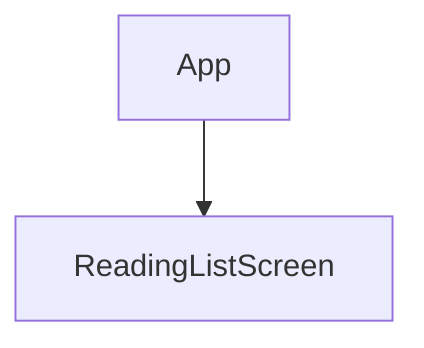
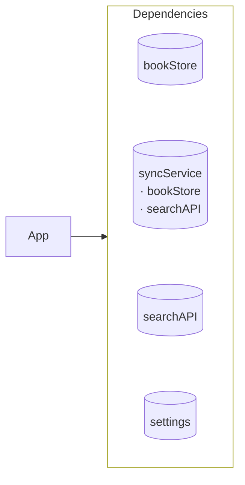
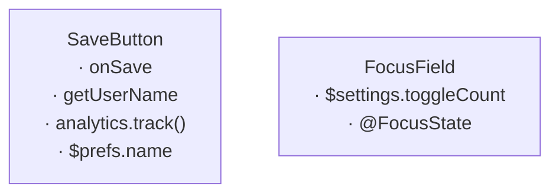

# Fixture: broken — DELIBERATELY WRONG, not an example

The clean fixture with fourteen errors and two warnings planted in it for
`scripts/test.sh`. Every block here violates the doctrine somewhere.
Never model a map on this directory.

## Unmounted

