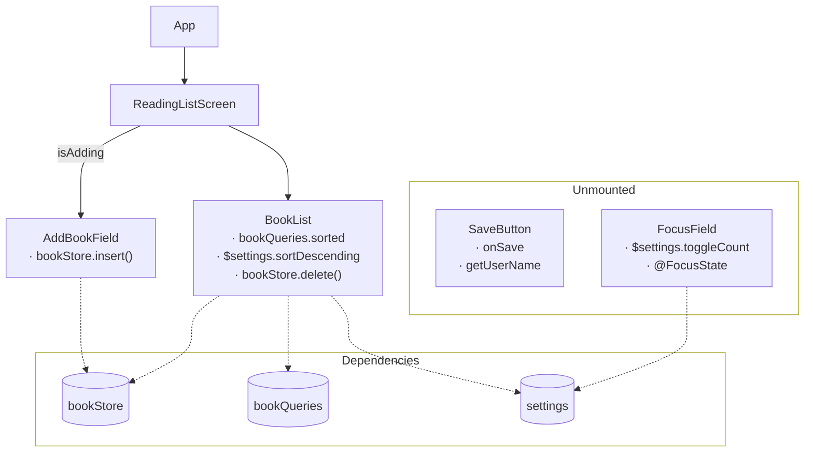
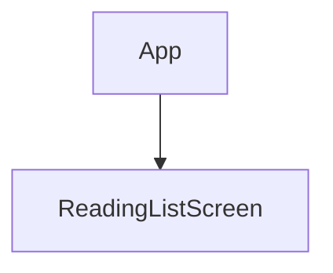
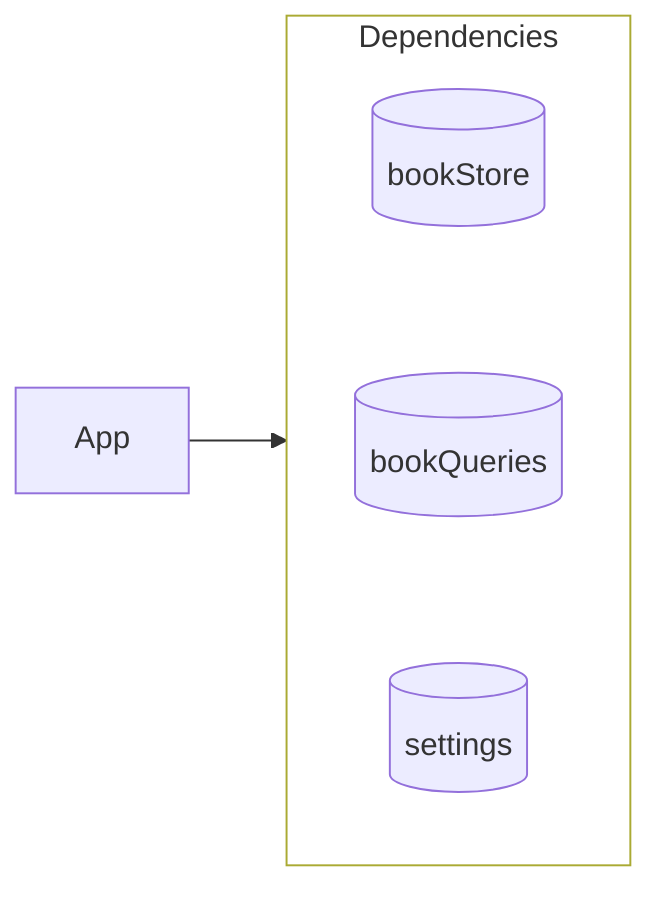
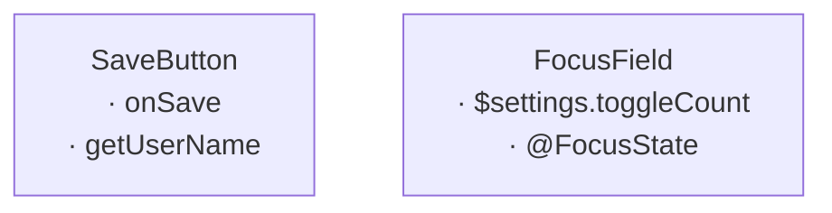

# Fixture: clean — CoreFlowExample's validated maps

<!-- whole-app: drawn by mapcheck.py --write from the maps below and under Maps/, never by hand -->

<!-- /whole-app -->

Regression input for `scripts/mapcheck.py`; must pass with zero errors.
These maps are correct by the doctrine and may be read as examples.

## Unmounted

