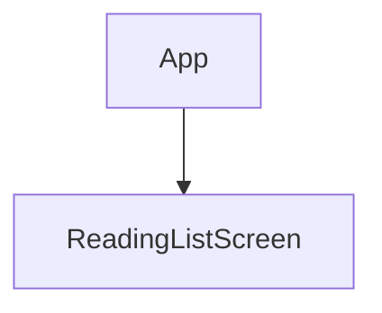
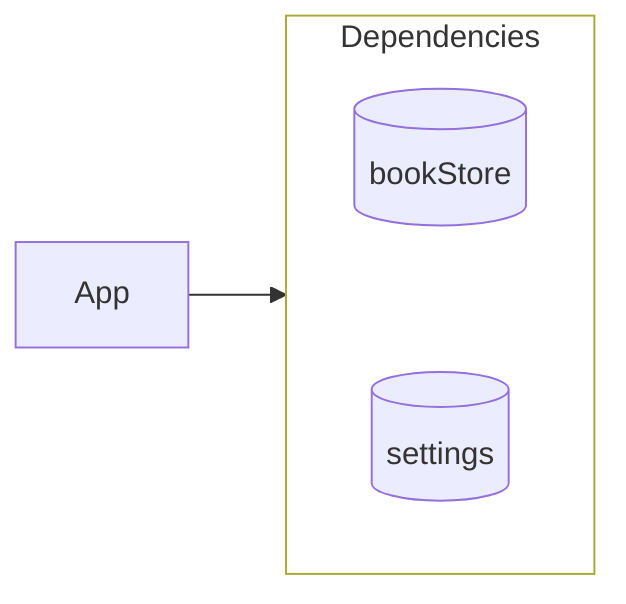
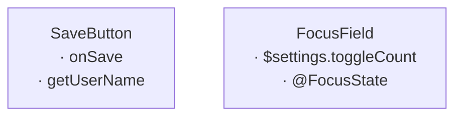

# Fixture: clean — CoreFlowExample's validated maps

Regression input for `scripts/mapcheck.py`; must pass with zero errors.
These maps are correct by the doctrine and may be read as examples.

## Unmounted

